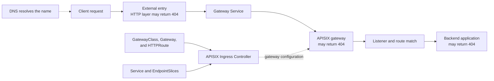

# Trace an APISIX 404 to its first failed handoff

## The question to answer

An HTTP `404` means a request did not find the requested
resource **somewhere** on its path. The status alone does not
prove that APISIX rejected the route: an HTTP-aware entry layer,
gateway, or backend application could have returned it. A Network
Load Balancer forwards network traffic; if it is the only AWS entry
layer, it does not create an HTTP `404` response itself.[^aws-nlb]
First identify the answering layer and the exact request it saw.

This guide uses a **made-up** `GET` request for
`https://learn.example.com/lessons` through an APISIX Gateway.
The example assumes the team declares routing with Gateway
API `HTTPRoute`. APISIX can also use Kubernetes Ingress or
APISIX custom resources; inspect the kind your cluster
actually uses.[^apisix-architecture][^apisix-gateway-api]
[^apisix-resources]
No gateway, route, Pod, or request was inspected for this page.
The cited APISIX Ingress Controller pages describe **v0.3.0**;
compare their behavior with your deployed controller and gateway versions.



Text alternative: DNS resolves the name before the request. A live
request crosses any external entry layer and the gateway Service,
then reaches APISIX for listener and route matching and possibly a
backend application. An HTTP-aware entry, APISIX, or the application
can return a `404`. Separately, the controller translates Gateway API
resources and Service/EndpointSlice information into APISIX
configuration. A route in Kubernetes does not prove this request
matched it. APISIX normally proxies directly to selected Pod endpoints.
[^apisix-architecture][^apisix-resources][^gateway-httproute]

## 1. Capture one failing request

Record the time, scheme, `Host`, path and query, HTTP method,
headers used by route matches, response status, and any request ID.
Redact secrets in headers and query values before sharing evidence.
Correlate the same request across the entry, APISIX, and backend logs
or traces. Check all gateway replicas that could receive it; an absent
line in one Pod's log does not prove the request missed APISIX.
Where logs include a route identity, upstream address, and upstream
response status, compare them with the backend log. An unmatched route
has no selected upstream, but a missing log field alone does not prove
that route matching failed. A response header or body alone
may be changed by a proxy and is not definitive attribution.
[^apisix-request-id]

If the request did not reach APISIX, inspect DNS, the external entry,
and the gateway Service before changing an `HTTPRoute`. If APISIX
forwarded it and the backend returned `404`, investigate the
application route and any path rewrite.

Keep the real request shape: testing only an IP address may change the
HTTP `Host` and, for HTTPS, TLS SNI. A host-preserving test such as
`curl --resolve` can target one entry address while keeping the URL
hostname in the HTTP request and HTTPS handshake. For the invented
request, its shape would be:

```bash
curl --resolve learn.example.com:443:192.0.2.10 https://learn.example.com/lessons
```

Replace the reserved example IP with the actual entry address. This
sends a real request, so use an approved read-only endpoint and the
team's incident procedure.[^curl-resolve]

## 2. Compare the request with the route

For the invented `lessons` route in namespace `lessons`,
the following commands only **read** Kubernetes objects.
Replace names and namespaces with your actual installation:

```bash
kubectl config view --minify
kubectl get httproute lessons -n lessons -o yaml
kubectl get gateway public-api -n gateway-system -o yaml
```

Confirm that the context maps to the cluster named in the incident
record before trusting the results. For this **invented** request,
imagine the route intends the following match:

| Check | Invented request | Intended route |
| --- | --- | --- |
| Listener | HTTPS on `public-api` | `parentRefs` names `public-api` in `gateway-system` and selects its HTTPS listener. |
| Host | `learn.example.com` | `hostnames` includes `learn.example.com`. |
| Method and path | `GET /lessons` | A `GET` match with `path.type: PathPrefix` and `path.value: /lessons`. |
| Backend | Not chosen by the client | `backendRefs` names the `lesson-api` Service and its port. |

This table is a reading aid, not a tested manifest. A request for
`/lesson` or a different host would miss **this** rule; another
attached route might still match it. Compare the real request with
`parentRefs[].sectionName` or `port`, listener protocol and hostname,
`hostnames`, path type and value, method, headers, and query parameters
that the route actually uses. If a route matched but the backend saw a
different path, inspect its rewrite filters too.[^gateway-httproute]
[^gateway-traffic-matching]

The route is in `lessons` and the Gateway is in `gateway-system`.
Gateway listeners allow routes from their **own** namespace by default.
Check the intended listener's `allowedRoutes.namespaces`: `from: All`
or a namespace-label `Selector` that matches `lessons` can permit this
cross-namespace attachment. Its `allowedRoutes.kinds` must also permit
`HTTPRoute` (the default for an HTTP or HTTPS listener).
`ReferenceGrant` does **not** authorize this route-to-Gateway link;
it governs cross-namespace references such as a route pointing to a
backend Service in another namespace.[^gateway-traffic-matching]
[^gateway-referencegrant][^gateway-api-spec]

Read the route's `status.parents` entry for the intended Gateway.
Check `Accepted`, `ResolvedRefs`, their reasons and messages, and
whether each condition's `observedGeneration` matches the route's
`metadata.generation`. Missing parent status can mean the intended
controller did not reconcile the route. On the Gateway, inspect the
listener's conditions and `attachedRoutes` count, and verify that its
GatewayClass names the expected controller. These are configuration
signals; even a current accepted route does not prove that the live
request matched it.[^gateway-status][^gateway-traffic-matching]

If a route refers to a backend in another namespace,
check the required `ReferenceGrant` in the backend namespace before
assuming the controller can use it. The APISIX support
matrix is version-specific, so verify that your installed
controller supports the Gateway API kind and fields in
the manifest.[^apisix-gateway-api][^gateway-referencegrant]

## 3. Check the controller-to-gateway handoff

When the Kubernetes route appears correct but the live request still
misses it, start with the route and Gateway conditions above. If they
are missing, stale, or report an error, inspect the controller's logs
in its actual namespace with your team's normal read access. A log
line's absence is weak evidence if logging is disabled or sampled.
For an invented controller Pod, a read-only command would be:

```bash
kubectl logs -n ingress-apisix apisix-ingress-controller-example --since=10m
```

Use the real namespace and Pod name, and inspect each controller
replica when there are several.
Then compare the controller's translated configuration with what each
APISIX gateway instance has applied. APISIX documents a controller
debug view at `/debug` and mode-specific administrative inspection:
standalone API-driven mode uses `/apisix/admin/configs` for the full
configuration, while etcd-backed mode exposes resources such as
`/apisix/admin/routes`.
These interfaces may expose routes, upstreams, or credentials; follow
your team's access procedure rather than enabling or forwarding an
administrative endpoint as a generic first step.
[^apisix-config-troubleshoot]

One **conditional** APISIX case is listener port matching. The Service
can map a Gateway listener's public port to a different port on which
APISIX accepts the connection. If the controller's
`listener_port_match_mode` is `auto` or `explicit`, it may add a
`server_port` condition to the generated route. That condition checks
APISIX's receiving port, so a mismatch can cause a `404`.
Check that setting and the actual listener path before
changing either value. For example, a Gateway listener can declare
port `80` while the Service forwards it to an APISIX listener on
`9080`; a generated match for `80` then misses. The setting
lives in the ingress controller configuration and defaults to `off`
in the referenced documentation.[^apisix-config-troubleshoot]

## 4. Follow the next boundary

| Evidence for this `404` | Next place to look |
| --- | --- |
| Correlated entry evidence exists, but no APISIX request evidence is found after checking logging and gateway replicas | DNS target, external entry, gateway Service, and APISIX Pod reachability. |
| APISIX received the request, but no route matched | Listener and `HTTPRoute` attachment, real match fields, controller translation, and conditional listener-port matching. |
| APISIX logged a different route identity than expected | That route's match and backend, including other attached routes or a directly configured APISIX route. |
| APISIX forwarded the request and the backend returned `404` | Application path, rewrite behavior, and matching backend log or trace. |
| A configured plugin produced the `404` | That plugin's settings and request evidence; do not assume every policy denial is a `404`. |

Route and upstream fields must be present in your APISIX logs or traces
before you can use them to identify the answering layer. APISIX exposes
a `route_id` variable for configured logging, but an ordinary `404`
response header or body is not reliable attribution by itself.
[^apisix-variables]

If the real status is `401`, `403`, `429`, or `5xx`, follow the actual
status and policy or upstream evidence. For a matched route with an
invalid backend reference, Gateway API specifies `500`; for a Service
with no ready endpoints, it recommends `503`. In the usual APISIX
Kubernetes path, inspect its selected Pod endpoints and EndpointSlice
readiness: APISIX normally sends traffic directly to Pod endpoints,
so the Service's virtual IP and kube-proxy may not be on this request
path. The [Kubernetes Service debug guide](https://kubernetes.io/docs/tasks/debug/debug-application/debug-service/)
helps check selectors and endpoint readiness.[^gateway-api-spec]
[^apisix-resources][^k8s-debug-service]

For a broader gateway request model, read
[How the APISIX gateway and controller fit together](../applications-and-tools/apisix-architecture-and-deployment.md).
For policy failures, read
[How APISIX policies shape one request](../applications-and-tools/apisix-security-traffic-and-observability.md).
Change the reviewed routing source only after the first
failed handoff is supported by evidence, then repeat the
same user request to verify the result.

## Check your understanding

1. Why is a `404` status insufficient to blame APISIX?
2. What can `HTTPRoute` status tell you, and what does a
   real request still need to match?
3. Why would a Gateway listener on port `80` need special
   attention if APISIX actually accepts traffic on `9080`
   and listener-port matching is enabled?

## Explore further

- [APISIX configuration troubleshooting](https://apisix.apache.org/docs/ingress-controller/reference/apisix-ingress-controller/configuration-troubleshoot/)
  explains translated versus synchronized configuration and
  the listener-port case.[^apisix-config-troubleshoot]
- [Gateway API HTTPRoute](https://gateway-api.sigs.k8s.io/reference/api-types/httproute/)
  explains parent attachment, hostnames, matches, and status.
  [^gateway-httproute]
- [APISIX Gateway API support](https://apisix.apache.org/docs/ingress-controller/concepts/gateway-api/)
  lists the supported resource versions and field limits.
  [^apisix-gateway-api]
- [Back to Kubernetes troubleshooting](index.md).

[^apisix-architecture]: [Apache APISIX, Deployment Architecture](https://apisix.apache.org/docs/ingress-controller/concepts/deployment-architecture/), source record `apisix-architecture`.
[^apisix-config-troubleshoot]: [Apache APISIX, Configuration Troubleshooting](https://apisix.apache.org/docs/ingress-controller/reference/apisix-ingress-controller/configuration-troubleshoot/), source record `apisix-config-troubleshoot`.
[^apisix-gateway-api]: [Apache APISIX, Gateway API support](https://apisix.apache.org/docs/ingress-controller/concepts/gateway-api/), source record `apisix-gateway-api`.
[^apisix-resources]: [Apache APISIX, Ingress Controller Resources](https://apisix.apache.org/docs/ingress-controller/concepts/resources/), source record `apisix-resources`.
[^gateway-httproute]: [Gateway API, HTTPRoute](https://gateway-api.sigs.k8s.io/reference/api-types/httproute/), source record `gateway-httproute`.
[^k8s-debug-service]: [Kubernetes, Debug Services](https://kubernetes.io/docs/tasks/debug/debug-application/debug-service/), source record `k8s-debug-service`.
[^aws-nlb]: [Elastic Load Balancing, NLB listeners](https://docs.aws.amazon.com/elasticloadbalancing/latest/network/load-balancer-listeners.html), source record `aws-nlb`.
[^gateway-referencegrant]: [Gateway API, ReferenceGrant](https://gateway-api.sigs.k8s.io/reference/api-types/referencegrant/), source record `gateway-referencegrant`.
[^gateway-traffic-matching]: [Gateway API, Traffic Matching](https://gateway-api.sigs.k8s.io/docs/concepts/traffic-matching/), source record `gateway-traffic-matching`.
[^gateway-status]: [Gateway API, Troubleshooting and Status](https://gateway-api.sigs.k8s.io/docs/concepts/troubleshooting/), source record `gateway-status`.
[^gateway-api-spec]: [Gateway API, API Reference](https://gateway-api.sigs.k8s.io/reference/api-spec/main/spec/), source record `gateway-api-spec`.
[^apisix-request-id]: [Apache APISIX, request-id](https://apisix.apache.org/docs/apisix/plugins/request-id/), source record `apisix-request-id`.
[^apisix-variables]: [Apache APISIX, Variables](https://apisix.apache.org/docs/apisix/apisix-variable/), source record `apisix-variables`.
[^curl-resolve]: [curl, manual (--resolve)](https://curl.se/docs/manpage.html), source record `curl-resolve`.
