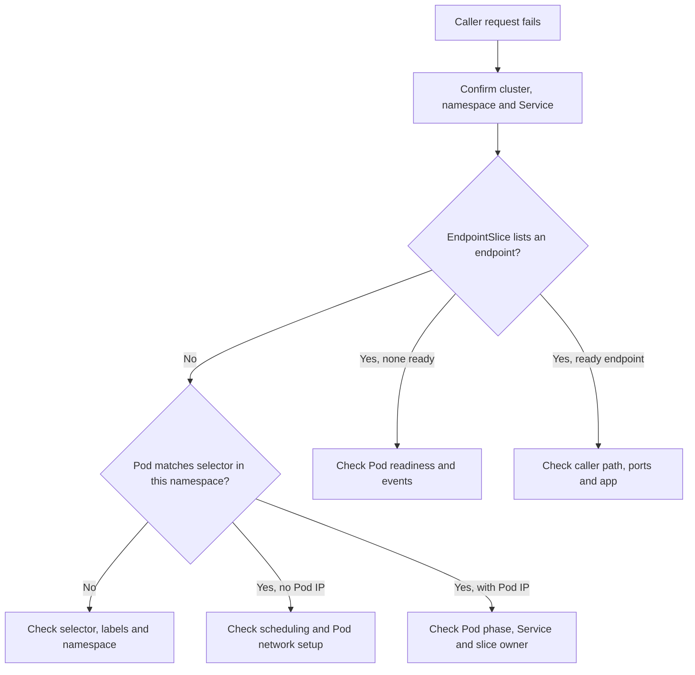

# Find the first failing Kubernetes boundary

## What this guide helps you decide

When an application fails, first ask **where the expected path
stops**. A Pod needs to be scheduled, obtain its image, start its
containers, and become ready. Separately, a selector-based Service
matches Pod **labels** in its namespace, whether those Pods are
ready or not. EndpointSlices record the matching backend addresses
and readiness conditions; the caller still needs a working route
and application response. A status word points to an observation,
not a proven root cause.[^pod-lifecycle][^service][^endpointslices]

Think of a delivery service: the address list is the Service
selector and matching Pod labels, while an availability light is
Pod readiness. Both inform the current delivery roster,
represented by EndpointSlices. The analogy has a limit: these
signals are maintained by separate controllers, several failures
can happen together, and a ready backend does not prove the
complete user journey works.



Text alternative: after a failed request, confirm the target and
the Service. If its EndpointSlices have no endpoints, check
whether Pods in the same namespace match the selector. No match
points to labels or namespace; a matching Pod without an IP points
to scheduling or Pod sandbox and network setup. A matching Pod
with an IP points to its phase, the Service, and the EndpointSlice
owner. If endpoints are listed but unready, inspect Pod readiness.
If at least one is ready,
inspect the caller's route, ports, and application response.
This decision path assumes an ordinary Service with a selector;
selectorless Services use separately managed EndpointSlices.
[^service]

## Start with read-only evidence

Know the intended cluster and namespace. These examples use
`shop` as an **invented namespace**:

```bash
kubectl config current-context
kubectl get pods -n shop -o wide
kubectl get events -n shop --sort-by=.metadata.creationTimestamp
```

Confirm the context-to-cluster mapping using the
[safe inspection guide](../commands/daily-usage.md). The Pod list
shows readiness, status, restarts, and placement. Events may
show a recent scheduling, image, probe, or mount failure, but
they are supplemental observations with limited retention; do
not invent a cause when they are absent.[^kubernetes-events]
The sorting field follows the official kubectl quick reference.
[^kubectl-quick-reference]

> [!WARNING]
> These checks read cluster information. Inspecting a Pod or
> Service may expose configuration and logs. Keep evidence
> within the appropriate team channel; do not paste secrets
> into a public report.

## Match the symptom to the first useful check

| What you see | Read next | What the result can mean |
| --- | --- | --- |
| Pod shows `Pending` | `kubectl describe pod <pod-name> -n shop` | `Pending` includes waiting for scheduling **or** image setup. Read conditions and events first; if `FailedScheduling` cites CPU or memory, use the [resource-pressure guide](../commands/workflows.md).[^pod-lifecycle][^debug-pods] |
| Pod shows `ErrImagePull` or `ImagePullBackOff` | Pod image reference, pull policy, and exact pull error in `describe` and Pod YAML. | The STATUS column shows a waiting reason; the Pod can still be in phase `Pending`. A `not found` image, registry authorization error, and connection timeout point to different checks. Read the full event instead of treating every pull failure as a missing image. For a local kind build, use the [kind image-pull guide](kind.md).[^pod-lifecycle][^debug-pods] |
| Container repeatedly restarts | Last terminated state, previous logs, and events. | Follow [Diagnose CrashLoopBackOff](crashloopbackoff.md); the delay itself is not the cause.[^pod-lifecycle] |
| Pod is Running but not Ready | Pod conditions, container states, and readiness events. | Readiness can block normal Service traffic even while a container runs.[^pod-lifecycle][^endpointslices] |
| Service has no usable backend | Service selector, matching Pod labels/IPs, readiness, and EndpointSlices. | No matching Pod, a matching Pod without an IP, and an unready endpoint are different branches; follow the example below.[^debug-services][^endpointslices] |
| Service has ready backends but callers still fail | First identify the caller: port-forward, an in-cluster Pod, or an Ingress/Gateway. Then inspect Service `port`/`targetPort`, the app listener, DNS, policy, and response. | Port-forward uses a separate tunnel to one Pod and does not prove the ClusterIP route works. Follow the [Service selection explanation](../core-objects/how-a-service-selects-pods.md) and [official Service debugging path](https://kubernetes.io/docs/tasks/debug/debug-application/debug-service/) from the caller's position.[^debug-services][^kubectl-port-forward] |
| `kubectl` returns `Forbidden` | Exact verb, resource, namespace, and identity. | Follow the [EKS human access guide](../../security/identity-federation/eks-human-identity-and-rbac.md) on EKS or your cluster's access process; permission denial is separate from workload readiness. |

This table is a route chooser, not a list of fixes. A `Pending`
Pod can be waiting for an image, and a Running Pod can still be
unready. Use the **event and condition** to distinguish them.
[^pod-lifecycle]

## Worked example: separate selection from readiness

Imagine an **invented** `web` Service in namespace `shop`.
An in-cluster caller cannot complete its request, and the Pod
list contains one `web` Pod marked `Running` but `0/1` Ready.
The Service uses `spec.selector: {app: web}` and maps its port `80`
to the application's port `8080`. These observations are
illustrative; no cluster was tested for this page. If a caller
reports HTTP `503`, identify which hop returned it; the status
alone does not identify the failing Kubernetes boundary.

First read the Service and its EndpointSlices:

```bash
kubectl describe service web -n shop
kubectl get endpointslices -n shop -l kubernetes.io/service-name=web -o yaml
kubectl get pods -n shop -o wide --show-labels
```

For this invented case, the Pod output and one item in the
EndpointSlice `items` list might include the following
**abridged, illustrative** lines:

```text
NAME                 READY   STATUS    IP          LABELS
web-7c8d9f-d3e4f    0/1     Running   10.0.2.12   app=web
```

```yaml
kind: List
items:
  - metadata:
      labels:
        kubernetes.io/service-name: web
        endpointslice.kubernetes.io/managed-by: endpointslice-controller.k8s.io
    addressType: IPv4
    ports:
      - protocol: TCP
        port: 8080
    endpoints:
      - addresses: [10.0.2.12]
        conditions:
          ready: false
          serving: false
          terminating: false
        targetRef:
          kind: Pod
          name: web-7c8d9f-d3e4f
```

The label matches, and the EndpointSlice contains the Pod's IP,
but `ready: false` says it is not an ordinary ready backend.
Inspect that Pod's conditions and readiness events before
changing Service configuration. If the same endpoint later has
`ready: true`, the ready-backend branch is reached. Confirm its
`targetRef.name`, when present, is an intended Pod and its `ports`
match the Service's `targetPort` and the application listener.
Then inspect the caller path; readiness alone does not prove the
full request works.[^endpointslices][^service]

If there are **no endpoints listed**, compare the Service's
`spec.selector` with Pod labels in `shop`. No matching Pod means
check the selector, labels, and namespace. A matching Pod that
has no IP yet sends you to scheduling or Pod sandbox and network
setup. If a matching Pod has an IP but there is still no
EndpointSlice entry, check its phase, whether the Service has a
selector, the slice's `endpointslice.kubernetes.io/managed-by`
label if any slice exists, and whether the controller has
reconciled. Do not infer a label error from an empty slice alone.
[^debug-services][^service][^endpointslices]

```bash
kubectl describe pod <pod-name> -n shop
kubectl logs <pod-name> -n shop --tail=100
```

Suppose the Pod description reports a failing readiness probe
and the logs say the application cannot reach a backend. The
next check is the application's backend dependency and probe
behavior. Do not make the probe less strict merely to turn
`0/1` into `1/1`: the Pod may really be unable to serve.
After a reviewed fix, repeat the Pod and EndpointSlice checks,
then test the original user request. A ready endpoint is still
only one checkpoint.[^debug-pods][^debug-services][^readiness-probes]

> [!NOTE]
> A Service with `publishNotReadyAddresses: true` can report
> EndpointSlice `ready: true` even when a Pod cannot serve.
> Check Pod readiness and the endpoint's `serving` condition
> before trusting that shortcut.[^endpointslices]

## When to stop and ask for help

Stop before a change when the cluster target is uncertain,
the needed data is forbidden, the proposed fix is not explained
by the evidence, or the system has a controller that will
reconcile your manual change away. Save the exact observation
and use the team's incident or change process. The
[manifest-change guide](../commands/common-commands.md)
starts only after a correction has been reviewed.

## Explore further

- [How a Kubernetes Service selects Pods](../core-objects/how-a-service-selects-pods.md)
  explains the label, readiness, EndpointSlice, and traffic paths.
- [Debug Pods](https://kubernetes.io/docs/tasks/debug/debug-application/debug-pods/)
  explains Pod conditions, container state, and events.[^debug-pods]
- [Debug Services](https://kubernetes.io/docs/tasks/debug/debug-application/debug-service/)
  follows DNS, Service, selected endpoints, and application
  response.[^debug-services]
- [EndpointSlices](https://kubernetes.io/docs/concepts/services-networking/endpoint-slices/)
  explains endpoint readiness and Service association.[^endpointslices]
- [Back to Kubernetes troubleshooting](index.md).

[^pod-lifecycle]: [Kubernetes, Pod Lifecycle](https://kubernetes.io/docs/concepts/workloads/pods/pod-lifecycle/), source record `pod-lifecycle`.
[^debug-pods]: [Kubernetes, Debug Pods](https://kubernetes.io/docs/tasks/debug/debug-application/debug-pods/), source record `debug-pods`.
[^debug-services]: [Kubernetes, Debug Services](https://kubernetes.io/docs/tasks/debug/debug-application/debug-service/), source record `debug-services`.
[^service]: [Kubernetes, Service](https://kubernetes.io/docs/concepts/services-networking/service/), source record `service`.
[^endpointslices]: [Kubernetes, EndpointSlices](https://kubernetes.io/docs/concepts/services-networking/endpoint-slices/), source record `endpointslices`.
[^kubectl-quick-reference]: [Kubernetes, kubectl Quick Reference](https://kubernetes.io/docs/reference/kubectl/quick-reference/), source record `kubectl-quick-reference`.
[^kubernetes-events]: [Kubernetes, Event API](https://kubernetes.io/docs/reference/kubernetes-api/events/event-v1/), source record `kubernetes-events`.
[^kubectl-port-forward]: [Kubernetes, kubectl port-forward](https://kubernetes.io/docs/reference/kubectl/generated/kubectl_port-forward/), source record `kubectl-port-forward`.
[^readiness-probes]: [Kubernetes, Liveness, Readiness, and Startup Probes](https://kubernetes.io/docs/concepts/workloads/pods/probes/), source record `readiness-probes`.
