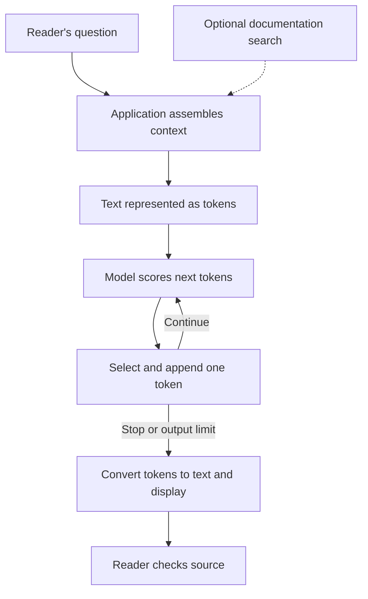

# How a large language model produces a response

## What you will understand

A **text-generating large language model (LLM)** is a model trained at scale
on language data to produce sequences of tokens. For a simple text response,
it takes the material supplied for this request and generates an output
sequence one **token** at a time. A token is a chunk of text: it might be a
word, part of a word, or a few characters including punctuation. By the end of
this page, you should be able to trace that sequence and explain why its
well-written result still needs checking.[^google-llm-introduction][^openai-key-concepts]

Start with [AI fundamentals](../ai/ai-fundamentals.md) if **model**,
**training**, or **inference** are new terms. This page follows one ordinary
text-generation call. An application with search, tool calls, images, or
other features has additional steps around or within that call.

## Why this matters

An LLM can draft a useful explanation quickly, but fluency is a poor test
of whether a particular fact is true. It may produce a plausible path
through a product interface that disagrees with that product's current
documentation. The model's learned patterns are not a live copy of every
source. NIST describes confidently presented false content from generative
AI as **confabulation**, often called a "hallucination."[^nist-genai-profile]

The practical habit is to ask: **What information did the model have for
this answer, and where can I check the claim?**

## The smallest accurate model

| Part | What it does |
| --- | --- |
| Application | Receives the reader's request and supplies instructions, relevant earlier turns, and any retrieved material it chooses to include. It may use a provider's conversation-state feature instead of resending every turn itself. |
| Context | The material available for this response, including the new question and tokens already generated in this response. It is limited in size. |
| Tokenizer | Represents text as tokens that the model can process. Tokens are not guaranteed to match word boundaries. |
| Model | Uses the current sequence to score possible next tokens. A decoding process selects one, appends it, and repeats. |
| Reader | Checks important claims against the source or other suitable evidence before acting. |

The **context window** is the finite space for a request's input and
generated output. The cited API guides count input and output tokens within
that limit. The exact size and handling differ by model and API. A longer
window does not guarantee that every detail in it will be used correctly.
If an input is too large, an API may reject it; shortening, summarizing, or
compacting material requires application or API behavior rather than an
assumption that the model remembers it all.[^openai-conversation-state][^anthropic-context-windows]

Earlier conversation matters only when the application or API makes it
available again. A previous message may be included, summarized, or left
out; do not assume a model has every earlier turn. An API-managed history
still uses context space when it reaches the model. Supplying a page in the
context helps it answer from that page, but it is **not training**. The
model's learned weights do not change merely because it answered this
request. [AI fundamentals](../ai/ai-fundamentals.md) explains the
training-versus-inference boundary.[^openai-conversation-state]

## An analogy: a mosaic from a small tray

Imagine an artist placing one tile at a time. A tray holds reference cards;
the board shows the tiles already placed. Before each new tile, the artist
looks at both and chooses a tile that fits. Their earlier practice
resembles training; the tray and board resemble the current context.
Someone else may bring a new reference card, as an application may
retrieve a document and add it to the model's input.

The analogy has limits:

- The artist can walk out and compare the mosaic with the real scene, which
  was not on the tray. A language model does not perform a live fact check
  merely by generating text; the application must supply a checking path,
  or a reader must use one.
- A tile is a physical shape. A token is a piece of encoded content, not
  necessarily a whole word or a complete idea.
- The artist may learn from each mosaic. This model does not change its
  weights during an ordinary response. Training or fine-tuning is a
  separate process.
- The artist intends to make a particular picture. The model scores token
  options from learned patterns; the analogy does not give it a human
  artist's intent.

The analogy shows **sequence and limited context**, not how model layers
or attention calculate the next-token scores.

## Follow one invented answer

A reader asks a fictional documentation assistant, **"Where do I export my
notes in Inkwell 2?"** Inkwell, the documentation snippet, and the answer
below are invented. No model or documentation search was run for this example.

1. The **application** searches its public documentation and finds a page
   that says: "In Inkwell 2, open Workspace, then Data export." Search is
   an application step; it does not happen just because the model is good
   at writing.
2. The application supplies its instructions, that page excerpt, and the
   reader's question as context. Its API may also supply relevant earlier
   turns. The text is represented as tokens.
3. At each generation step, the model assigns scores to possible next
   tokens. A decoding process selects one token; depending on its settings,
   it may sample rather than always choose the top candidate. The selected
   token becomes part of the sequence used for the next step. This repeats
   until a stop condition or output limit.[^google-llm-introduction][^openai-conversation-state]
4. Suppose the displayed answer says: "Open Settings, then Data export."
   It sounds reasonable, but **Settings** contradicts the supplied page's
   **Workspace**. Within this invented example, the reader can compare
   the answer with the supplied excerpt. In a real assistant, the reader
   should open the cited documentation before relying on the menu path.
   A source link makes checking possible; it does not prove that the
   answer followed the source correctly.[^nist-genai-profile]

Text alternative: The reader sends a question to the application. The
application may search for documentation, then supplies the question and
chosen context. That text becomes tokens. The model repeatedly scores
possible next tokens and a decoding process appends one. After a stop or
output limit, the application displays the answer and the reader checks
its factual claim against the documentation. In this example, search happens
before generation. With tool calling, a model may request a search during a
larger task; [How AI agents use tools](../ai-agents/agent-fundamentals.md)
traces that different flow.

## Three operations that are easy to mix up

| Operation | When it happens | What changes |
| --- | --- | --- |
| Training or fine-tuning | Before this ordinary response, in a separate process | The model's weights may change. |
| Retrieval | Before or during a request, if the application or an enabled tool performs it | The application obtains outside material; the model has not seen it until it is supplied. |
| Adding context | For this response | The request includes chosen material; the model can use it without changing its weights. |

In the Inkwell example, retrieval found the page, context included its
excerpt, and generation produced the answer. None of those steps trained
the model. If no current Inkwell page had been supplied or fetched, the
model's remembered patterns would not establish the current menu path.

## Common wrong assumptions

- **"It always looks up the answer."** A plain text-generation call need
  not include search. An application or enabled tool must provide a path
  to current information.
- **"It remembers every earlier message."** The application or API
  decides which earlier material reaches the current request. A long
  conversation may be shortened or summarized; an over-limit input can
  also be rejected.[^openai-conversation-state][^anthropic-context-windows]
- **"It writes the whole answer in one step."** The output is produced
  as a sequence of tokens. Seeing them arrive one by one does not show
  how each token's score was computed.[^google-llm-introduction]
- **"It sounds sure, so it must be right."** Fluent text can contradict
  a supplied source. Check consequential claims in the source itself.[^nist-genai-profile]

## Check your understanding

1. In the invented Inkwell example, who found the documentation page?
2. What is a token, and does it always equal a word?
3. If an earlier message is not supplied in this request's context, can
   you assume the model can still refer to it?
4. Did the retrieved page change the model's weights? Why can the answer
   still be wrong even when the right page is present?

## Answer guide

1. The application searched and supplied the page. The model did not
   fetch it in this example.
2. A token is a chunk of encoded text and can be a whole word, part of one,
   or punctuation.
3. No. Only material the application or API makes available for the
   current request can be used as conversation context.
4. No. Adding a page to context is not training. Generation selects likely
   next tokens; it does not necessarily copy or verify a supplied page.
   The model may produce a familiar-looking menu path that contradicts
   the correct path in the page.

## Go deeper

- [AI fundamentals](../ai/ai-fundamentals.md) separates training,
  inference, models, assistants, and agents.
- [Retrieval and context efficiency](../ai/ai-tooling/knowledge-bases/retrieval-and-context-efficiency.md)
  explains how an application finds and checks material before using it
  for an answer.
- [How AI agents use tools](../ai-agents/agent-fundamentals.md) explains
  what changes when a model can request another tool step.
- [Google's introduction to LLMs](https://developers.google.com/machine-learning/crash-course/llm/transformers)
  explains tokens and the Transformer architecture.
- [OpenAI's conversation-state guide](https://developers.openai.com/api/docs/guides/conversation-state)
  and [Claude's context-window guide](https://platform.claude.com/docs/en/build-with-claude/context-windows)
  explain how those APIs handle history and request limits.

This page is `draft`. The example and diagram explain a general text path;
they are not a measured model run, product evaluation, or guarantee that a
particular LLM uses every supplied detail correctly.

[Back to LLM](index.md)

[^google-llm-introduction]: [Google for Developers - What's a large language model?](https://developers.google.com/machine-learning/crash-course/llm/transformers).
[^openai-key-concepts]: [OpenAI API - Key concepts](https://developers.openai.com/api/docs/concepts).
[^openai-conversation-state]: [OpenAI API - Conversation state](https://developers.openai.com/api/docs/guides/conversation-state).
[^anthropic-context-windows]: [Claude Platform - Context windows](https://platform.claude.com/docs/en/build-with-claude/context-windows).
[^nist-genai-profile]: [NIST AI 600-1 - Artificial Intelligence Risk Management Framework: Generative Artificial Intelligence Profile, §2.2 Confabulation](https://nvlpubs.nist.gov/nistpubs/ai/NIST.AI.600-1.pdf).
