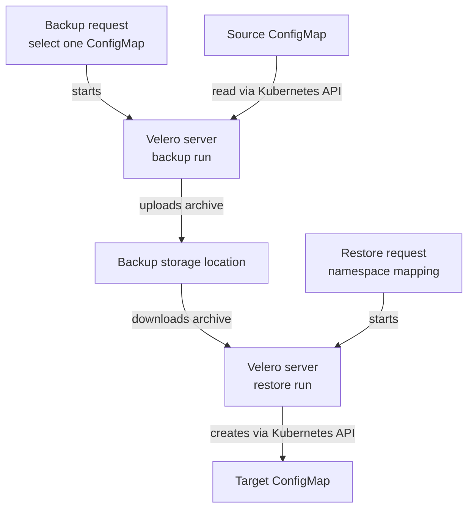

# Back up and restore one ConfigMap with Velero

## What you will do

Create one disposable ConfigMap, back it up, restore a copy into a
second namespace, and read its value. This small exercise
proves that Velero can select, store, and recreate **that Kubernetes object** in
this environment. It does **not** test a persistent volume, a database,
an application, a schedule, or disaster recovery.[^velero-backup]
[^velero-restore]

Imagine putting one labeled note in an archive and asking a clerk to
place a copy in a second room. The note is our ConfigMap. The archive
receipt is the Velero backup; the copy in the second room is the
restore. A receipt alone does not prove the copy has the right words.
Velero also stamps the restored copy with the backup and restore names.



Text alternative: A Backup request tells the Velero server to read the
source ConfigMap through the Kubernetes API and upload its archive to
the backup storage location. A Restore request tells that same server
to download the archive and create the ConfigMap in the mapped target
namespace. The reader then checks its value and restore labels.[^velero-how]

This guide follows the Velero v1.18 references below. The exercise has
not been run in a live cluster for this page; check your installed
version's help if a command or output differs.

## Before you begin

You need a disposable Kubernetes cluster, a working `kubectl` context,
a Velero v1.18 installation, a Velero CLI that matches the server, and
an available BackupStorageLocation in `ReadWrite` mode. You must be allowed to
create two namespaces and ConfigMaps in this cluster. Use the same
shell and cluster context for every step. Do not run this against a
production cluster merely to follow the example.

The names below are reserved for this exercise:
`kb-velero-source`, `kb-velero-target`, `kb-velero-note`,
`kb-velero-note-backup`, and `kb-velero-note-restore`. First confirm
that none already exists. If any does, choose a different consistent
set of names; do not overwrite or delete someone else's resource.

```bash
kubectl config current-context
velero version
velero backup-location get
kubectl get namespaces kb-velero-source kb-velero-target
velero backup get kb-velero-note-backup
velero restore get kb-velero-note-restore
```

The namespace check should report `NotFound` for both names. Each Velero
check should report a **not-found error for its exact record name**; the
wording may differ from `kubectl`. A permission or connection error is
not evidence that a name is free.
`velero version` must show a server version; stop if it cannot reach the
server. These commands assume Velero runs in its default `velero`
namespace; if yours differs, pass `-n <velero-namespace>` to each Velero
command. The chosen backup location must show `Available` and
`ReadWrite`. Its `DEFAULT` column needs to be `true` when the backup
command omits `--storage-location`. If another location is intended, add
`--storage-location <name>` to the backup command after confirming its
bucket and prefix. Review the context and location rather than assuming
that the CLI targets the cluster you intended.[^velero-locations]

## 1. Create the small source

```bash
kubectl create namespace kb-velero-source
kubectl create namespace kb-velero-target
kubectl -n kb-velero-source create configmap kb-velero-note \
  --from-literal=message='This note came from the source namespace.'
kubectl -n kb-velero-source label configmap kb-velero-note \
  kb-velero-exercise=note
kubectl -n kb-velero-source get configmap kb-velero-note \
  -o jsonpath='{.data.message}'
```

The final output should be `This note came from the source namespace.`
It may appear beside the next shell prompt because JSONPath does not add
a newline. Keep both namespaces dedicated to this exercise. Kubernetes
commonly creates a
`kube-root-ca.crt` ConfigMap in each namespace, so the label selects
only our note for backup.[^k8s-service-accounts] A ConfigMap stores
configuration data, not a persistent volume.

## 2. Back up the ConfigMap

```bash
velero backup create kb-velero-note-backup \
  --include-namespaces kb-velero-source \
  --include-resources configmaps \
  --selector kb-velero-exercise=note \
  --snapshot-volumes=false \
  --wait
velero backup describe kb-velero-note-backup --details
velero backup logs kb-velero-note-backup
```

The namespace, resource, and label filters limit this backup to the
labeled ConfigMap in the source namespace. The volume-snapshot flag
makes the object-only scope explicit.[^velero-resource-filtering] In
`describe`, check that `Phase` is `Completed`, the storage location is
the one you chose, and warnings and errors are zero. Its `Resource List`
should show only `v1/ConfigMap` with
`kb-velero-source/kb-velero-note`; neither `kube-root-ca.crt` nor other
objects belong in this backup. If the phase, location, result counts,
or resource list differ, stop and investigate. A failed validation may
not have an uploaded log.
`--wait` alone is not an application recovery check.[^velero-backup]

The CLI downloads logs and detailed resource lists through a signed
storage URL. If `logs` or that part of `describe` fails with a URL or
DNS error, the download may have failed even when `Phase` is
`Completed`. Check the phase and counts separately; fix client access
to the backup location before claiming the resource-list check passed.
Velero's Minio guide explains this case.[^velero-minio]

## 3. Restore into the prepared target

First prove that this namespace does not already have the exercise note:

```bash
kubectl -n kb-velero-target get configmap kb-velero-note
```

Expect `NotFound`. Stop on any other result, including a permission
error. The namespace itself is not empty: Kubernetes may have created
default objects in it. The important condition is that **this ConfigMap**
is absent before Velero recreates it.[^velero-restore]

```bash
velero restore create kb-velero-note-restore \
  --from-backup kb-velero-note-backup \
  --namespace-mappings kb-velero-source:kb-velero-target \
  --wait
velero restore describe kb-velero-note-restore --details
velero restore logs kb-velero-note-restore
kubectl -n kb-velero-target get configmap kb-velero-note \
  -o jsonpath='{.data.message}'
kubectl -n kb-velero-target get configmap kb-velero-note --show-labels
```

The value should match the source note. The labels should include
`velero.io/backup-name=kb-velero-note-backup` and
`velero.io/restore-name=kb-velero-note-restore`. Check that `describe`
shows `Completed` with zero errors and warnings. Its `Resource List`
should show `kb-velero-target/kb-velero-note(created)` if the details
download succeeds. The before check, matching value, and restore labels
together are stronger evidence than a `Completed` status alone. Velero
normally skips a destination object that already exists.[^velero-restore]

If the restore's detailed list or logs cannot be downloaded, use its
phase and error counts plus the target-object checks separately. Do not
call the detailed-list check complete until the CLI can reach the
storage URL.[^velero-minio]

If the Restore did not complete cleanly, the object is absent, the
value differs, or a label is missing, leave the namespaces and Velero
records in place for diagnosis. A namespace mapping changes where
namespaced objects are created; it cannot make an incompatible API or
unavailable volume data usable.[^velero-restore] After diagnosis, use
the named-resource cleanup below when you are ready to discard this
exercise.

## 4. Clean up this exercise

Only after recording the backup, restore, and value results, confirm
the cluster context and exact names again. This conservative cleanup
deletes the named note in each namespace and the two Velero records:

```bash
kubectl config current-context
kubectl -n kb-velero-source delete configmap kb-velero-note
kubectl -n kb-velero-target delete configmap kb-velero-note
velero restore delete kb-velero-note-restore
velero backup delete kb-velero-note-backup
velero restore get kb-velero-note-restore
velero backup get kb-velero-note-backup
kubectl -n kb-velero-source get configmap kb-velero-note
kubectl -n kb-velero-target get configmap kb-velero-note
```

Check each Velero delete prompt's exact name before confirming it.
The two `kubectl` checks should report `NotFound`; the Velero checks
should report not-found errors for the exact names. Backup deletion can
finish after its command returns. If its phase is still `Deleting`, wait
and repeat the check before concluding it is gone.
Deleting the backup removes its stored data and this test recovery
point, while deleting a Restore record does not undo restored objects.
The two namespaces remain. If this is **your isolated disposable
cluster**, you created both namespaces in step 1, and no other actor
has used them, remove them too:

```bash
kubectl delete namespace kb-velero-source
kubectl delete namespace kb-velero-target
kubectl get namespaces kb-velero-source kb-velero-target
```

The final check should report `NotFound` for both names after namespace
deletion finishes. On a shared cluster, first have the namespace owner
review every namespaced resource, including custom resources, before
deleting either namespace. `kubectl get all` is not a complete inventory:
it omits ConfigMaps, Secrets, and most custom resources. If ownership
or contents are uncertain, leave the namespace in place. If any cleanup
command fails, inspect what remains rather than assuming it finished.

## What this exercise did not prove

| Next question | Follow this route |
| --- | --- |
| Where do PVC data and snapshots live? | [Where a Velero backup keeps objects and volume data](storage-and-volume-backups.md). |
| How do schedules, filters, hooks, and restore changes work? | [Velero backup reference](https://velero.io/docs/v1.18/backup-reference/), [restore reference](https://velero.io/docs/v1.18/restore-reference/), and [resource filtering](https://velero.io/docs/v1.18/resource-filtering/). |
| Will an application recover in another cluster? | [Cluster migration and disaster recovery](cluster-migration-and-disaster-recovery.md) and an authorized restore drill with application data checks. |

## Check your understanding

1. Why must the target lack `kb-velero-note` before the restore?
2. What do the restored value and Velero labels prove beyond `Completed`?
3. Why would this exercise be insufficient for the notes app with a PVC
   from the [storage comparison](storage-and-volume-backups.md)?

[Back to Velero index](index.md)

[^velero-backup]: [Velero v1.18 - Backup Reference](https://velero.io/docs/v1.18/backup-reference/).
[^velero-restore]: [Velero v1.18 - Restore Reference](https://velero.io/docs/v1.18/restore-reference/).
[^velero-how]: [Velero v1.18 - How Velero Works](https://velero.io/docs/v1.18/how-velero-works/).
[^velero-locations]: [Velero v1.18 - Backup and Snapshot Locations](https://velero.io/docs/v1.18/locations/).
[^velero-minio]: [Velero v1.18 - Quick Start Evaluation Install with Minio](https://velero.io/docs/v1.18/contributions/minio/).
[^velero-resource-filtering]: [Velero v1.18 - Resource Filtering](https://velero.io/docs/v1.18/resource-filtering/).
[^k8s-service-accounts]: [Kubernetes - Managing Service Accounts](https://kubernetes.io/docs/reference/access-authn-authz/service-accounts-admin/).
