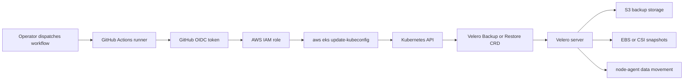

# Velero possible integrations

## Purpose

Use this page to understand how Velero can be triggered from automation systems such as GitHub Actions, what the pipeline can safely do, and what configuration must already exist in AWS, EKS, Kubernetes, and Velero.

The example focuses on GitHub Actions running against Amazon EKS. The same operating model applies to other automation runners: the runner authenticates to the cloud, connects to the cluster, creates Velero `Backup` or `Restore` custom resources, waits for completion, and publishes logs for review.

## Contents

- [Can Velero run from a pipeline?](#can-velero-run-from-a-pipeline)
- [Automation model](#automation-model)
- [Pipeline modes](#pipeline-modes)
- [Required platform setup](#required-platform-setup)
- [Instruction file](pipeline-workflow-reference.md#instruction-file)
- [Default GitHub Actions workflow](pipeline-workflow-reference.md#default-github-actions-workflow)
- [Velero configuration needed by the pipeline](pipeline-workflow-reference.md#velero-configuration-needed-by-the-pipeline)
- [Security and approval controls](#security-and-approval-controls)
- [Operating process](#operating-process)
- [Failure handling](#failure-handling)

## Can Velero run from a pipeline?

Yes. The Velero CLI is only a client that creates and inspects Velero Kubernetes custom resources. A GitHub Actions runner can run the CLI the same way an operator does from a workstation.

The pipeline does not need direct access to object storage backup data. It needs:

- Cloud identity that can connect to the target cluster.
- Kubernetes access to create and inspect Velero resources in the `velero` namespace.
- A Velero server already installed in the cluster.
- A working `BackupStorageLocation`.
- Snapshot, node-agent, and data mover configuration when volume data is part of the operation.

> [!IMPORTANT]
> A pipeline can standardize backup and restore commands, but it does not make migrations automatically safe. Restores and migration cutovers still need application owner validation, data consistency planning, and rollback decisions.

## Automation model



What it shows: GitHub Actions authenticates to AWS with short-lived credentials, connects to EKS, creates Velero resources, and lets the Velero server perform backup or restore work.

## Pipeline modes

| Mode | Target cluster | What it does |
| --- | --- | --- |
| `backup` | Source or normal production cluster | Creates a manual backup for selected namespaces or the full cluster resource set. |
| `migration-backup` | Source cluster | Creates a migration-oriented backup, usually with File System Backup or data movement for portable PVC file data. |
| `restore-test` | Non-production or isolated target cluster | Restores a backup into mapped namespaces for validation. |
| `migration-restore` | Destination cluster | Restores a migration backup after destination prerequisites are ready. |

> [!WARNING]
> `restore-test` and `migration-restore` can create workloads, Secrets, PVCs, Services, Ingresses, and cloud load balancers. Protect these modes with GitHub environments, required reviewers, and a non-production default target.

## Required platform setup

| Area | Requirement |
| --- | --- |
| GitHub OIDC | AWS trusts `token.actions.githubusercontent.com` and only the intended repository, branch, or environment can assume the role. |
| GitHub environment | Use an environment such as `production-velero` with required reviewers for restore and migration modes. |
| AWS IAM role for GitHub Actions | Allows `eks:DescribeCluster` and, when needed, assumes or maps to the EKS cluster access role. |
| EKS access | The IAM role is authorized in EKS access entries or Kubernetes RBAC to create and inspect Velero CRDs. |
| Velero server | Installed in the cluster with provider plugins, `BackupStorageLocation`, and optional snapshot/data movement configuration. |
| Velero CLI | Installed by the workflow on the runner. |
| Object storage | S3 bucket, prefix, encryption, lifecycle, and access policy are already configured. |
| Volume backup path | EBS/CSI snapshots, CSI data movement, or File System Backup is tested before migration use. |

## Security and approval controls

| Control | Why it matters |
| --- | --- |
| GitHub environment required reviewers | Prevents accidental restore or migration runs from starting without human approval. |
| OIDC instead of static AWS keys | Avoids long-lived cloud secrets in GitHub. |
| Branch and environment-scoped trust policy | Prevents other repositories or branches from assuming the backup role. |
| `execute` defaults to false | Lets operators generate and inspect the command before running it. |
| Separate source and destination operation files | Avoids running a restore against the wrong cluster during migration. |
| Least-privilege Kubernetes RBAC | Limits what the automation runner can create directly. |
| Backup storage encryption and lifecycle | Protects Secrets and limits cost. |

## Operating process

1. Confirm Velero server is healthy in the target cluster.
2. Create or update `.github/velero/operation.json`.
3. Open the GitHub Actions workflow.
4. Select the mode that matches the instruction file.
5. Run with `execute=false` first and review the generated command.
6. Re-run with `execute=true` after approval.
7. Review backup or restore logs.
8. For restores, validate Kubernetes state and application data before cutover.

### Source-side migration backup

```json
{
  "mode": "migration-backup",
  "aws_account_id": "111122223333",
  "aws_region": "eu-west-1",
  "cluster_name": "legacy-eks",
  "github_actions_role_arn": "arn:aws:iam::111122223333:role/github-actions-velero-operator",
  "cluster_role_arn": "arn:aws:iam::111122223333:role/eks-velero-operator",
  "backup_name": "team-a-migration-20260726",
  "namespaces": [
    "team-a"
  ],
  "full_cluster_resources": false,
  "include_cluster_resources": false,
  "snapshot_volumes": false,
  "default_volumes_to_fs_backup": true,
  "ttl": "168h",
  "backup_storage_location": "default",
  "volume_snapshot_locations": []
}
```

What it does: backs up the `team-a` namespace and uses File System Backup for eligible pod volumes so the backup is more portable across clusters or providers.

### Destination-side migration restore

```json
{
  "mode": "migration-restore",
  "aws_account_id": "111122223333",
  "aws_region": "eu-west-1",
  "cluster_name": "tooling-eks",
  "github_actions_role_arn": "arn:aws:iam::111122223333:role/github-actions-velero-operator",
  "cluster_role_arn": "arn:aws:iam::111122223333:role/eks-velero-operator",
  "restore_name": "team-a-migration-restore-20260726",
  "restore_from_backup": "team-a-migration-20260726",
  "namespaces": [
    "team-a"
  ],
  "namespace_mappings": {
    "team-a": "team-a"
  },
  "existing_resource_policy": "none"
}
```

What it does: restores the migration backup into the destination cluster after Velero has synced backup metadata from object storage.

## Failure handling

| Failure | First checks |
| --- | --- |
| Workflow cannot assume AWS role | Check GitHub environment, OIDC trust `sub`, `id-token: write`, and role ARN. |
| `aws eks update-kubeconfig` fails | Check `eks:DescribeCluster`, region, cluster name, and optional cluster role trust. |
| `kubectl auth can-i` fails | Check EKS access entries, `aws-auth`, or Kubernetes RBAC binding. |
| `velero backup-location get` is unavailable | Check Velero server, S3 bucket, region, credentials, and network. |
| Backup is `PartiallyFailed` | Run `velero backup describe <name> --details` and inspect skipped resources or volume failures. |
| Restore collides with existing objects | Restore into mapped namespaces or deliberately use an existing-resource policy after review. |
| PVCs stay pending after restore | Check StorageClass mapping, CSI driver, snapshot access, and `DataDownload` or `PodVolumeRestore` status. |

## Related pages

The full pipeline implementation has its own page:

- [Velero pipeline workflow reference](pipeline-workflow-reference.md) - Copy and adapt the instruction file, default GitHub Actions workflow, and Velero configuration that a backup and restore pipeline needs.

## Related links

- [GitHub Actions OIDC with AWS](https://docs.github.com/en/actions/how-tos/secure-your-work/security-harden-deployments/oidc-in-aws)
- [GitHub Actions environments](https://docs.github.com/en/actions/reference/workflows-and-actions/deployments-and-environments)
- [AWS configure credentials action](https://github.com/aws-actions/configure-aws-credentials)
- [AWS EKS update-kubeconfig](https://docs.aws.amazon.com/cli/latest/reference/eks/update-kubeconfig.html)
- [Velero backup reference](https://velero.io/docs/v1.18/backup-reference/)
- [Velero restore reference](https://velero.io/docs/v1.18/restore-reference/)
- [Backup and restore workflows](backup-restore-workflows.md)
- [Cluster migration and disaster recovery](cluster-migration-and-disaster-recovery.md)
- [Back to Velero index](index.md)
- [Back to migrations index](../index.md)
- [Back to root index](../../../README.md)
