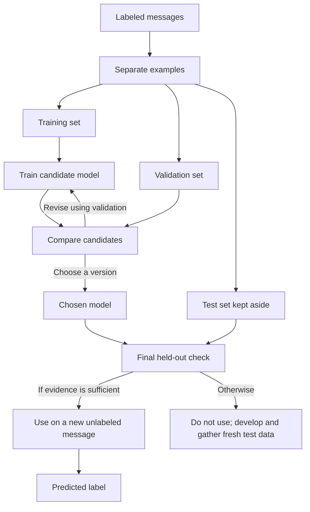

# How supervised classification learns from examples

## What you will understand

**Machine learning (ML)** builds a model from data so it can make a
prediction or produce content for a new input. **Supervised
classification** is one kind of ML: training examples have known labels,
and the model learns to choose among those labels for a new example. This
page follows that path and shows why doing well on the examples it saw is
not enough evidence that it will do well later.[^google-what-is-ml][^google-supervised-learning]

Start with [AI fundamentals](../ai/ai-fundamentals.md) if **model**,
**training**, and **inference** are new words. ML also includes approaches
that do not use labels and models that generate content. The fixed-label
task here is a first example, not a definition of all ML.

## Why the held-out check matters

A model that fits training examples much better than new ones because it
learned details specific to those examples is **overfitting**. A useful
model must **generalize**: its predictions
should work on examples it did not train on and on the real inputs it will
receive. Held-out examples help reveal that problem: validation examples
are kept out of training but inform model choices; test examples are kept
out of both training and those choices.[^google-overfitting][^google-dividing-datasets]

## The smallest accurate model

| Term | Meaning in the library example below |
| --- | --- |
| Example | One message sent to the library. |
| Feature | Input information the model uses, such as which words occur in the message. Software first turns the raw text into those features. |
| Label | The correct routing team assigned under a stated rule: `membership` or `room-booking`. |
| Model | A method and fitted values that connect features with predicted labels. It is not a hand-written list of every message. |
| Training | Adjusting the model using examples whose labels are known, so its predictions better match them. |
| Inference | Using the trained model on a new message without a supplied label, producing a predicted label. |

The **features** are what the model is allowed to use as input. The
**label** is what it is trying to predict. During evaluation, the label
is retained for checking the prediction; it is not given to the model as
an input feature.[^google-supervised-learning]

## An analogy: a help-desk sorting tray

A new library volunteer reads a tray of earlier notes, each stamped with
the team that handled it. A coordinator keeps two other stamped stacks
hidden from the volunteer. The coordinator uses the first hidden stack to
compare approaches and the second only after choosing one. Then an
unstamped note arrives and the volunteer routes it.

| In the analogy | In this ML task |
| --- | --- |
| Stamped notes used for practice | Training examples and labels |
| Volunteer's sorting habits | Model fitted from the examples |
| First hidden stack used for choosing an approach | Validation set |
| Second hidden stack opened after that choice | Test set |
| New unstamped note | New input at inference |

The analogy has limits. A person can ask a colleague and decide that
neither team fits. This two-label model has no such option unless the
surrounding system adds a rejection or review path. The volunteer may
learn from every new note; an inference request does not update this
model. A model can also fit accidental clues in the examples rather than
following a person's reasoning.[^google-overfitting]

## Follow one invented library router

Everything in this section is fictional. No dataset was collected, no
classifier was trained, and no accuracy was measured. The tiny table is for
tracing the steps, not for estimating real performance.

The library's labeling rule is: **card, account, and access requests or
problems go to `membership`; requests to reserve or change a room booking
go to `room-booking`.** The two-label dataset contains only messages staff
can assign under this rule. A real router also needs a separate path for
messages outside these two teams.

| Group | Message | Known label |
| --- | --- | --- |
| Training | “How do I renew my card?” | `membership` |
| Training | “Can I update my account email?” | `membership` |
| Training | “Please reserve the quiet room.” | `room-booking` |
| Training | “Cancel my group room booking.” | `room-booking` |
| Validation | “My card was lost. How do I replace it?” | `membership` |
| Validation | “Move my room reservation to Friday.” | `room-booking` |
| Test | “Can my daughter get a library card?” | `membership` |
| Test | “Change the meeting room booking from Tuesday to Thursday.” | `room-booking` |

1. **Prepare and split.** The team decides which messages and labels are
   suitable, then keeps training, validation, and test examples separate.
   Text is turned into features, such as the presence of words.[^google-supervised-learning]
2. **Train.** The model adjusts its values against the four training labels.
   A correct training answer shows it fitted a seen example; it does not
   prove that the model handles a new message.[^google-supervised-learning][^google-overfitting]
3. **Choose.** The validation messages help compare candidate versions,
   perhaps ones that count different words as features. Using validation
   results to choose is their purpose. Repeated choices based on the same
   validation set can make its result less reliable as an estimate; a
   separate final test remains untouched.[^google-dividing-datasets]
4. **Check once.** After choosing, the team evaluates on the held-back test
   messages. Suppose, only for illustration, that it gets both right.
   Two examples still cannot estimate future accuracy. A keyword rule
   such as “route messages containing *room* to `room-booking`, otherwise
   to `membership`” also gets these two right. The result does not show
   that ML adds value. A real test needs enough representative, independent
   examples and an error measure chosen for the task. If the result is not
   acceptable, the team returns to development and needs fresh test data
   for a new independent check; it must not tune against these test messages
   and then call them an untouched final test.[^google-dividing-datasets]
5. **Predict only after a sufficient check.** In a system that passed a
   meaningful evaluation, a new message, “Can I reserve a study room for
   Saturday?”, arrives without a label. A plausible prediction is
   `room-booking`. The known labels were used during training and
   evaluation, not supplied as part of this new input. This toy check is
   too small to approve such a system.[^google-supervised-learning]

Text alternative: Labeled messages are separated into training,
validation, and test sets. Training examples adjust a candidate model;
validation examples help compare and revise candidates. After a version
is chosen, the held-back test examples check it. Only sufficient evidence
supports using the model on a new unlabeled message; otherwise the team
stops, improves the design, and gathers fresh test data. The test set does
not feed the training or version-choice loop.[^google-dividing-datasets]

## When a prediction needs extra care

The test split is useful only when it resembles the messages that will
arrive later. In the tiny table, every booking example contains *room*
and no membership example does. Even a perfect result on that test could
miss a shortcut on the word *room*. For example, “My card does not open the
study room door” is a **membership** access problem under the stated rule.
A model that relies too strongly on the word *room* could misroute it to
`room-booking`. That would be a possible shortcut, not an observed result.
“The printer on floor two is jammed” belongs to neither label. A two-label
classifier still has to output one unless the application adds a
rejection or human review path.

Other warning signs include duplicate or near-duplicate messages across
the split, fitting a word list or another learned preprocessing step on
all examples rather than only training data, changing the model after
reading test results, and new messages that differ from those collected
for training. Use the same fitted preprocessing on later data. These
problems can make a held-out result look better than real use.[^google-dividing-datasets][^sklearn-common-pitfalls][^google-overfitting]

Compare with a simple baseline before assuming ML adds value. A rule that
always says `membership` needs no training. If almost all real messages
were membership questions, that rule could have high overall accuracy
while missing every room booking: its recall for `room-booking` would be
zero. Check errors for each team and the cost of those errors, not only
one overall number. Google's classification
guide explains accuracy, precision, and recall in detail.[^google-classification-metrics]

## Common wrong assumptions

- **“It got the training messages right, so it works.”** Seen examples
  test fit, not generalization to new messages.
- **“Validation and test are the same.”** Validation informs choices; the
  final test is held back from those choices.[^google-dividing-datasets]
- **“A high overall accuracy means every team is served well.”** An
  imbalanced set can hide an entire class of misses.[^google-classification-metrics]
- **“A prediction teaches the model.”** This inference uses the chosen
  model. Updating it would require a separate training process.
- **“A predicted label proves the message belongs to one of the categories.”** A
  two-label classifier can still be given an out-of-scope message.

## Check your understanding

1. In “Please reserve the quiet room,” what is the label? What could be
   one feature of the message?
2. Why must the team not tune the model using the two test messages and
   then call its result a fresh final test?
3. What would “always answer `membership`” fail to do, even if membership
   messages were common?
4. Why might “My card does not open the study room door” be misrouted?
5. What changes during training, and what happens during inference?

## Answer guide

1. `room-booking` is the label. The presence of the word “reserve” could
   be one feature; the team still needs a consistent way to turn text into
   features.
2. The test messages would influence the team's model choice and cease to
   be an untouched check of that choice.
3. It would miss every real room booking. Overall accuracy alone could
   conceal that failure.
4. A model could learn the accidental clue “room” from training examples
   where that word always meant booking, while the stated rule sends
   card-access problems to `membership`.
5. Training adjusts the model from labeled examples. Inference uses that
   chosen model to predict a label for a new, unlabeled example.

## Go deeper

- [How an ML model stays useful after deployment](../mlops/mlops-fundamentals.md)
  follows a tested candidate into versioned release, monitoring, and
  human-reviewed correction.
- [AI fundamentals](../ai/ai-fundamentals.md) distinguishes ML, language
  models, training, and inference.
- [How a large language model produces a response](../llm/llm-fundamentals.md)
  shows one text-generation path, a different kind of model output.
- [Google's supervised-learning introduction](https://developers.google.com/machine-learning/intro-to-ml/supervised)
  explains labeled examples, features, training, evaluation, and inference.
- [Google's dataset-splitting lesson](https://developers.google.com/machine-learning/crash-course/overfitting/dividing-datasets)
  explains the distinct training, validation, and test roles.
- [scikit-learn's common pitfalls](https://scikit-learn.org/stable/common_pitfalls)
  shows how preprocessing and data leakage can invalidate a check.
- [Google's classification metrics guide](https://developers.google.com/machine-learning/crash-course/classification/accuracy-precision-recall)
  explains why overall accuracy can mislead.

This page is `draft`. Its messages and hypothetical outcomes are teaching
examples, not measured classifier performance or evidence that this router
would work for a real library.

[Back to ML](index.md)

[^google-what-is-ml]: [Google for Developers - What is machine learning?](https://developers.google.com/machine-learning/intro-to-ml/what-is-ml).
[^google-supervised-learning]: [Google for Developers - Supervised learning](https://developers.google.com/machine-learning/intro-to-ml/supervised).
[^google-dividing-datasets]: [Google for Developers - Datasets: Dividing the original dataset](https://developers.google.com/machine-learning/crash-course/overfitting/dividing-datasets).
[^google-overfitting]: [Google for Developers - Overfitting](https://developers.google.com/machine-learning/crash-course/overfitting/overfitting).
[^google-classification-metrics]: [Google for Developers - Classification: Accuracy, recall, precision, and related metrics](https://developers.google.com/machine-learning/crash-course/classification/accuracy-precision-recall).
[^sklearn-common-pitfalls]: [scikit-learn - Common pitfalls and recommended practices](https://scikit-learn.org/stable/common_pitfalls).
