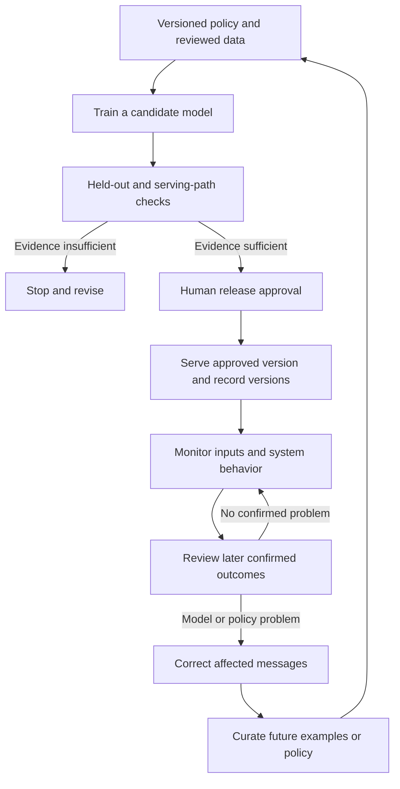

# How an ML model stays useful after deployment

## What you will understand

**MLOps** is the work of releasing and maintaining a machine-learning system:
its data, model, surrounding software, checks, and response when something
changes. A model that passed an earlier test can still make poor decisions on
new messages or be used incorrectly by its application. By the end of this
page, you should be able to trace one version from reviewed examples to live
predictions, then explain how people detect and correct a problem without
assuming the model fixes itself.[^google-production-systems][^google-monitoring]

Start with [How supervised classification learns from
examples](../ml/supervised-classification-fundamentals.md) for features,
labels, training, and held-out checks. This page continues its **fictional**
library-message router. No model was trained, deployed, or measured for
either page.

## The story so far

The library's initial rule sends card, account, and access problems to
`membership`; room reservations and changes go to `room-booking`. The message
“My card does not open the study room door” is therefore a `membership`
problem. A model that learned the shortcut *room means room-booking* **might**
misroute it. The small examples in the previous page cannot tell us whether
any real model would do that.

Even a genuinely well-evaluated version needs a plan for new inputs, changed
rules, and software failures. That is why the model is only one part of the
operated system.[^google-production-systems]

## An analogy: editions of a desk handbook

Imagine that the library issues an editioned handbook to desk staff. A
reviewer checks example messages against the current routing policy before
the edition is issued. Staff use the approved edition; a coordinator watches
for mistakes and decides whether to correct a message, revise the policy, or
prepare another edition. The old edition is kept so the team can see which
guidance was in use when a mistake happened.

The analogy has limits. A trained model learns statistical relationships from
examples rather than reading a handbook of written rules. It does not read a
new policy memo or learn from each prediction in this design. An old edition
may contain an old mistake too. Reissuing an old edition changes future
decisions; it cannot undo messages already sent to the wrong queue.

## Follow one possible release

The versions and decisions below are **illustrative names**, not records of a
real system. Suppose a team wants to try the two-label router. It could use
this controlled path:

1. **Record the rule and review examples.** Save the label policy as `P1`
   and a reviewed, privacy-appropriate example set as `D1`. Staff resolve
   ambiguous messages under `P1`, record why, and mark messages outside its
   two teams for human handling rather than forcing a label. Hard in-scope
   cases stay in the evaluation mix. The *card opens room door* case belongs
   in a meaningful access-problem check; one hand-picked case alone cannot
   establish quality.
2. **Train a candidate.** Use a training portion of `D1` to produce a
   candidate `M1`. Record the training code and **preprocessing** version:
   preprocessing turns raw messages into model inputs, perhaps by removing
   signatures. Another person can then identify what produced `M1`.
   Training changes the candidate, not the already serving
   version.[^google-rules-of-ml]
3. **Evaluate before release.** Keep validation for choosing an approach and
   an untouched representative test for a final check. Compare `M1` with a
   simple rule or existing staff process; inspect errors for each team and
   access messages, not just one overall score. Test the **serving path**
   too: the live route through preprocessing, the model, and the
   application's routing code. If evidence is insufficient, stop rather
   than release.[^google-deployment-testing]
4. **Approve and serve a version.** A responsible person checks the agreed
   release criteria and approves the model **only if** the evidence is good
   enough. This example uses human approval. The application keeps an
   inspectable release record for the model, data, policy, preprocessing,
   and application versions. For a prediction it records a time, message
   identifier, model version, predicted team, and queue actually chosen,
   subject to the library's privacy and retention rules. A model prediction
   and the application's routing action are separate facts.
5. **Watch and review.** Check input format, queue distribution, missing
   features, delivery failures, and response time promptly. Once staff
   review a representative sample and confirm correct queues, ideally
   without seeing the model's prediction first, the team compares
   predictions with those labels, including access-problem messages.
   Investigate a change before deciding to retrain.[^google-monitoring]
6. **Correct and consider a new version.** Staff repair affected message
   routes. Reviewed errors may become carefully selected future examples.
   A candidate `M2` repeats evaluation and approval; it does not silently
   replace `M1` because new messages arrived.[^google-training-frequency]

Text alternative: Versioned policy and reviewed data feed candidate training.
Held-out and serving-path checks either stop the release or lead to human
approval. An approved model serves predictions with version records. The
team monitors inputs and system behavior, then reviews confirmed outcomes.
With no confirmed problem, monitoring continues. For a model or policy
problem, the team corrects affected messages and may curate examples or a
policy change. Revised policy and examples are versioned again, and any
later candidate returns to the same checks and approval gate.

This diagram follows the model-update route. An application defect or
training-serving skew calls for a checked software or preprocessing fix
instead of model retraining. There is no direct arrow from a prediction
to retraining.

## What monitoring can and cannot tell you

The right label may arrive only after a staff member checks where a message
belonged. Before then, the team can observe input shape, missing fields,
predicted-queue shares, delivery failures, and perhaps staff reroutes. Those
are **signals to investigate**, not measurements of routing correctness.
Even a low reroute count misses errors nobody noticed. A model's own
confidence is also not proof that its answer is correct. A reviewed sample
and later outcomes make quality assessment possible; the sample must include
important kinds of messages rather than only easy or already disputed ones.
Google's monitoring guidance separates pipeline health from quality on live
data and warns that whole-set metrics can hide a weak subgroup, such as
access problems.[^google-monitoring]

## Similar symptoms, different causes

Suppose staff see more messages in the wrong queue. These possibilities call
for different checks:

| Possible cause | What may have happened | First useful check |
| --- | --- | --- |
| New kinds of messages | People begin asking about a new door-badge system, which `D1` scarcely represents. | Compare current inputs with `D1`, then have staff review a suitable sample. Input changes are a clue, not proof of error. |
| Changed policy or label set | The library adds a `facility-access` team. The old two-label model cannot output it. Identical incoming text can now need a different answer. | Compare current staff-approved rules with `P1`. Input statistics alone cannot reveal a changed correct answer. |
| Training-serving skew | Training stripped email signatures but the serving application leaves them in, so the model sees differently prepared text. | Compare the same safe example after training and serving preprocessing, and check expected fields, formats, and feature statistics in both paths. |
| Application defect | `M1` predicts `membership`, but a routing-code bug sends that prediction to the room-booking queue. | Compare the recorded prediction, model version, application version, and queue actually used. |

Here **training-serving skew** means training and serving inputs or features
do not match as intended. A changed library policy is a change in the
desired answer; a routing-code defect is a failure after the model predicts.
Google describes input-format and feature skew and recommends monitoring
both model and application behavior.[^google-monitoring]

## Decide what to change

If the policy becomes `P2` with `facility-access` as a new team, `M1` cannot
produce that third label. Staff need a safe route for those messages now,
perhaps manual handling while they change the application and collect
reviewed `P2` examples. A future model would need the new label, fresh
evaluation under `P2`, and another approval. Retraining on `M1`'s own
predictions would repeat possible mistakes rather than provide confirmed
answers. Other systems train on a schedule or continuously and may use
automated release criteria. They still need data and quality checks suited
to their task; this library example uses reviewed labels and human release
approval.[^google-training-frequency]

If a newly released model causes harm, the team may **roll back** future
predictions to a known earlier version or switch to a staff-reviewed route.
Rollback works only if the old model, matching preprocessing, and
configuration still fit the current application and policy. At the first
release there is no earlier model, so the fallback must be another route.
The earlier model may share the *room* shortcut or follow an outdated policy,
so rollback is a decision to check, not an automatic cure. Use version and
time records to find messages already affected, review their correct team,
and repair their routing separately. Rolling back a model cannot recall a
message someone already received.[^google-productionization]

## Common wrong assumptions

- **“The test passed, so the model will stay good.”** A test describes the
  data and policy used for it; new messages, rules, or integration code can
  change the outcome.
- **“New predictions train it automatically.”** Serving `M1` only produces
  predictions in this design. A reviewed label and a separate gated training
  and release path would be needed here. Other designs can retrain
  automatically from suitable feedback under their own checks.
- **“A healthy dashboard proves predictions are right.”** Input and service
  signals can look normal while the correct routing policy changes.
- **“Rollback fixes every mistake.”** It affects future routing; earlier
  misrouted messages need their own review and repair.

## Check your understanding

1. Which versions would help identify how one message was predicted and
   routed?
2. The share of `room-booking` predictions rises. Does that prove the model
   is wrong? What evidence would help?
3. The library creates a `facility-access` team. A week later, `M1` has
   not predicted that team for any message. Why, and what should staff do
   today?
4. `M1` predicts `membership`, but the message reaches `room-booking`. What
   would you inspect before retraining?
5. After an email-client update, live messages include signatures that
   training removed. Which cause from the table is this, and what is the
   first check?
6. A release is rolled back today. What happens to messages misrouted last
   week?

## Answer guide

1. The model, data, label-policy, preprocessing, and application versions;
   also compare the recorded prediction with the queue actually used.
2. No. More room reservations, perhaps during exam season, could make the
   rise correct. Review a suitable sample against staff-confirmed labels
   and check whether message mix, policy, preprocessing, or routing code
   changed.
3. `M1` has only two output labels and cannot invent the third. Provide a
   staff-reviewed route now; then update the label policy, data, model or
   rules, evaluation, and approval.
4. Compare the model's recorded output with application routing and release
   versions. The model may have predicted correctly while code sent it to
   the wrong queue.
5. Training-serving skew. Compare the same privacy-safe example after
   training preprocessing and after live preprocessing, then check whether
   signatures account for the difference.
6. They remain where they went. Find the affected time and version range,
   review those messages, and correct their routes separately.

## Go deeper

- [How supervised classification learns from examples](../ml/supervised-classification-fundamentals.md)
  explains training, validation, test, and inference before release.
- [Google's production ML systems course](https://developers.google.com/machine-learning/crash-course/production-ml-systems)
  maps the other components around a model.
- [Google's deployment-testing lesson](https://developers.google.com/machine-learning/crash-course/production-ml-systems/deployment-testing)
  covers quality, infrastructure, and pipeline checks before release.
- [Google's monitoring lesson](https://developers.google.com/machine-learning/crash-course/production-ml-systems/monitoring)
  covers live-data quality, important slices, and training-serving skew.
- [Google's static-versus-dynamic training lesson](https://developers.google.com/machine-learning/crash-course/production-ml-systems/static-vs-dynamic-training)
  explains different update cadences and their monitoring costs.
- [Google's productionization guide](https://developers.google.com/machine-learning/managing-ml-projects/production)
  describes logging, rollout, and a documented rollback plan.

This page is `draft`. The library story, version names, and decisions are
teaching examples, not evidence of a trained or operated router. No live
system, domain expert, or beginner reader has validated the example.

[Back to MLOps](index.md)

[^google-production-systems]: [Google for Developers - Production ML systems](https://developers.google.com/machine-learning/crash-course/production-ml-systems).
[^google-deployment-testing]: [Google for Developers - Production ML systems: Deployment testing](https://developers.google.com/machine-learning/crash-course/production-ml-systems/deployment-testing).
[^google-monitoring]: [Google for Developers - Production ML systems: Monitoring pipelines](https://developers.google.com/machine-learning/crash-course/production-ml-systems/monitoring).
[^google-training-frequency]: [Google for Developers - Production ML systems: Static versus dynamic training](https://developers.google.com/machine-learning/crash-course/production-ml-systems/static-vs-dynamic-training).
[^google-rules-of-ml]: [Google for Developers - Rules of Machine Learning](https://developers.google.com/machine-learning/guides/rules-of-ml).
[^google-productionization]: [Google for Developers - Productionization](https://developers.google.com/machine-learning/managing-ml-projects/production).
