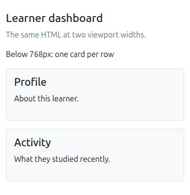
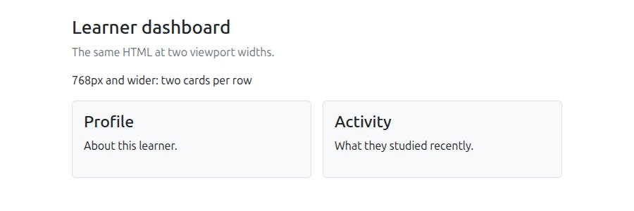

# Bootstrap frontend toolkit

## Purpose

Use this page when someone asks you to "add Bootstrap" to a web page. You
will learn what Bootstrap supplies, what your own HTML and application still
must supply, and how to recognize a missing stylesheet or JavaScript bundle.
The examples use the Bootstrap 5.3 documentation; check the official page for
the exact files and version used by your project.

## What it is

Bootstrap is a frontend toolkit. Its CSS supplies prepared layout, spacing,
and visual styles that your HTML selects with class names. Its base styles
also adjust ordinary elements such as the page body and headings. Its
optional JavaScript supplies behavior for components such as modals and
dropdowns.[^bootstrap-introduction]

A class such as `btn` does not create a new HTML element. It is a label on an
ordinary element that Bootstrap's stylesheet matches. In the same way,
`data-bs-toggle` attributes can tell Bootstrap's JavaScript to operate a
component, but the JavaScript bundle must also be loaded on the page. The
official guide places its script just before `</body>`.

Imagine a set of reusable building parts. A Bootstrap class selects a part;
the HTML still says what the part is and contains. The analogy stops at
accessibility and meaning: a styled `div` does not become a semantic
`button` just because it looks like one.

## One small layout

Imagine a small learner dashboard with two cards. Bootstrap decides their
width, but the same HTML supplies both the content and the reading order.
Start the HTML file with `<!doctype html>`, load the Bootstrap 5.3 CSS using the
[official getting-started guide](https://getbootstrap.com/docs/5.3/getting-started/introduction/)
and include this viewport tag in the page's `<head>`:

```html
<meta name="viewport" content="width=device-width, initial-scale=1">
```

Then put this markup in the `<body>`:

```html
<main class="container py-4">
  <h1 class="h3">Learner dashboard</h1>
  <div class="row g-3">
    <section class="col-12 col-md-6">
      <div class="p-3 border rounded bg-body-tertiary">
        <h2 class="h4">Profile</h2>
        <p>About this learner.</p>
      </div>
    </section>
    <section class="col-12 col-md-6">
      <div class="p-3 border rounded bg-body-tertiary">
        <h2 class="h4">Activity</h2>
        <p>What they studied recently.</p>
      </div>
    </section>
  </div>
</main>
```

`container` centers the content, adds side padding, and caps its width from
the small breakpoint upward; `row` holds grid columns; `g-3` adds space
between columns and between cards that wrap onto new lines. Each `col-12`
occupies all 12 grid columns below the medium breakpoint. At a viewport
width of **768 px or more**,
`col-md-6` assigns each section six of the 12 columns, so the cards sit
side by side. The inner `p-3 border rounded bg-body-tertiary` classes add
padding, a border, rounded corners, and a subtle background (pale in the
default light color mode); the grid classes alone do not draw a card.[^bootstrap-grid]

A preview page containing this grid markup, plus an introductory sentence
and a width label, was rendered in one local browser with Bootstrap CSS
5.3.8. The [complete preview file](../../tests/bootstrap-grid-5.3.8.html)
pins that stylesheet and needs no Bootstrap JavaScript. The screenshots
record that local rendering:





The browser check also measured separate rows at 767 px and the same row at
768 px. This verifies this sample's CSS layout in one browser; device and
assistive-technology behavior still needs independent review. If the boxes
stay unstyled, inspect the stylesheet request in the browser's Network
panel. If styled boxes never share a row, check that the viewport is at least
768 CSS pixels wide (browser zoom can change this), each `col-md-6` is a
direct child of the `row`, and the class names are spelled correctly. If a
phone shows both cards side by side in a zoomed-out page, check for a missing
viewport tag.

## CSS and JavaScript have different jobs

| Need | Bootstrap supplies | You still supply |
| --- | --- | --- |
| A styled button | CSS for `btn` and a variant such as `btn-primary`. | A real `<button>`, its label, and what clicking it does. |
| A responsive grid | Grid classes and breakpoint styles. | The content order, meaningful headings, and a layout that works for your users. |
| A modal | Component styles and JavaScript behavior, when the required bundle or plugin is loaded. | The dialog content, a `<button>` trigger, an accessible dialog label, and application action after confirmation.[^bootstrap-modal] |

The official quick start shows CDN files with version-specific integrity
hashes. Copy the exact CSS and JavaScript links for the version you choose;
do not reuse an old integrity hash with a new file. A mismatched hash makes
the browser refuse that file; the Console reports an integrity error.
Projects with a build pipeline can install Bootstrap through a package
manager instead.[^bootstrap-introduction][^bootstrap-download]

For a modal that looks styled but does not open, check that the JavaScript
bundle loaded without errors, the trigger has `data-bs-toggle="modal"`, and
its `data-bs-target` is `#` followed by the modal's exact `id`. Separately,
give the modal `aria-labelledby` pointing to its title so assistive
technology can announce it. The grid example above needs the CSS but no
Bootstrap JavaScript.[^bootstrap-modal]

## Decide whether to use it

Bootstrap can speed up a prototype or a conventional application interface
when its established patterns match the design. If a product has a specific
design system or only needs a small amount of CSS, compare the cost of
adapting Bootstrap with writing those styles directly. The toolkit does not
choose product language, information architecture, or interaction design for
you.

## Check your understanding

- Which part styles a `btn` class: the browser alone or the loaded
  Bootstrap CSS?
- Why can a modal's trigger button look styled even when the modal never
  opens?
- At 900 px, the cards have borders and padding but still stack. Is the
  stylesheet missing, or is something else wrong?

**Answers:** (1) The loaded Bootstrap CSS; a browser has no built-in `btn`
style. (2) The button's look comes from CSS; opening the modal needs
JavaScript, and the trigger must target the correct modal. (3) The visible
border and padding show that the stylesheet loaded. Check browser zoom,
whether each column is a direct child of `row`, and the class spelling.

## Official documentation for deeper study

- [Bootstrap getting started](https://getbootstrap.com/docs/5.3/getting-started/introduction/) shows the supported first-page setup.
- [Bootstrap grid system](https://getbootstrap.com/docs/5.3/layout/grid/) explains rows, columns, and breakpoints.
- [Bootstrap modal](https://getbootstrap.com/docs/5.3/components/modal/) documents a component that needs JavaScript behavior.
- [Bootstrap download](https://getbootstrap.com/docs/5.3/getting-started/download/) covers installation choices.

## Related links

- [Bootstrap and bootstrapping](bootstrap-and-bootstrapping.md)
- [Bootstrapping a system](bootstrapping-a-system.md)
- [Back to programming languages](index.md)
- [Back to knowledge index](../index.md)

[^bootstrap-introduction]: [Bootstrap - Get started](https://getbootstrap.com/docs/5.3/getting-started/introduction/), source record `bootstrap-introduction`.
[^bootstrap-grid]: [Bootstrap - Grid system](https://getbootstrap.com/docs/5.3/layout/grid/), source record `bootstrap-grid`.
[^bootstrap-modal]: [Bootstrap - Modal component](https://getbootstrap.com/docs/5.3/components/modal/), source record `bootstrap-modal`.
[^bootstrap-download]: [Bootstrap - Download and package managers](https://getbootstrap.com/docs/5.3/getting-started/download/), source record `bootstrap-download`.
