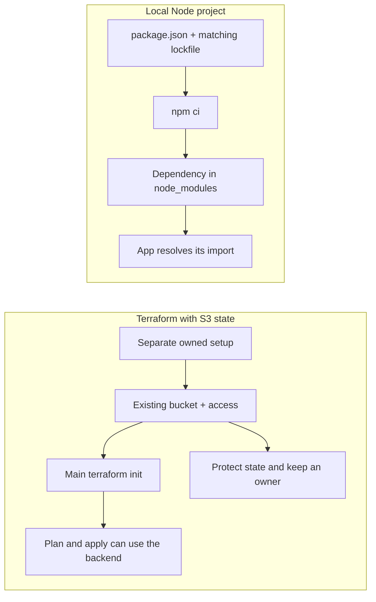

# Bootstrapping a system

## Purpose

Use this page when a project or infrastructure tool cannot start because a
normal step assumes something already exists. You will learn to find that
first dependency, decide who prepares it, and check when ordinary work can
begin. The local project example was run; the cloud example is conceptual.

## The idea

**Bootstrapping** prepares the minimum foundation a normal workflow needs
before that workflow can run. A Node project may need its packages installed
before its code can import them. A Terraform configuration using an S3 state
backend needs the bucket and access in place before it can initialize that
backend.[^npm-install][^terraform-s3-backend]

Ask: **What does the usual first step assume is already there?** Name that
dependency, its owner, and a check that proves it is usable. The tool itself
must also be installed: `npm ci` cannot run without npm, and `terraform init`
cannot run without Terraform. Installing the tool and preparing what it
depends on are different steps.

Think of laying a foundation before building a house. The house can be used
after construction, but it still depends on that foundation. This analogy
has a limit: some project setup, such as installing packages, is repeated in
each new working copy, while shared state storage is maintained for the
infrastructure's entire life.

## Two paths through the dependency order

Text alternative: in the local project, `package.json` and its matching lockfile
let npm install the declared dependency, after which the app can resolve its
import. In the infrastructure example, a separate owned setup creates the
S3 bucket and grants access before the main configuration initializes its
backend. Normal Terraform work then uses that state; the bucket continues
to need protection and an owner.

Bootstrapping describes the order, not a special command. A script called
`bootstrap` may do any number of things. Inspect its files, scripts,
credentials, and target before running it.

## Local example: a missing Node package

A small [local demo project](../../tests/bootstrapping-node-demo/README.md)
imports `learning-greeting`, a package kept beside the app. Its
`package.json` declares the dependency, and its `package-lock.json` records
the installation choice. Node.js and npm were already installed. In a
disposable copy of this fixture on 2026-10-15, Node.js v22.23.2 and npm
10.9.8 produced these results:

| Check | Observed result |
| --- | --- |
| `npm start` before installation | `ERR_MODULE_NOT_FOUND`: the app could not find `learning-greeting`. |
| `npm ci --ignore-scripts --offline --no-audit --no-fund` | Added a link to the local package in `node_modules`; `--offline` prevented a registry download. |
| `npm start` afterward | Printed `Hello, Ada!` |

Use `npm install` when intentionally adding or changing dependencies; that
can update `package-lock.json`. Use `npm ci` to install from an existing
matching lockfile. It clears any existing `node_modules` first and does not
rewrite the manifest or lockfile. The local run checked the clean-install
path; it did not compare the commands after changing a dependency.[^npm-ci][^npm-install]
This proof is narrow: the demo imports one local package. It does not prove
that another project's environment variables, database, or external
services work.

Install commands can run lifecycle scripts from the project or its
dependencies. `--ignore-scripts` kept them off for this demo; a real project
may require reviewed scripts to build native code or prepare assets. Read
the project's setup instructions and its dependency policy before
installing unfamiliar code.[^npm-scripts][^npm-ci]

## Shared example: a Terraform state backend

This example is conceptual: no AWS bucket or Terraform run was performed for
this page. A team wants its main Terraform configuration to store state in
Amazon S3. The S3 backend names an existing bucket. Terraform reads the
backend configuration during `terraform init`, before normal resource
operations; a backend block cannot refer to a resource or other named value
in that same configuration. If the backend is configured before the bucket
exists, initialization cannot use that backend to create it. The bucket must
be prepared before enabling the backend. One possible two-stage route uses
local state to create the bucket, then migrates state; this couples the
bucket's management to the state it holds and needs a deliberate recovery
plan. The example below uses a separate owned setup instead.
[^terraform-backend][^terraform-init][^terraform-s3-backend]

1. An owner chooses the bucket, access path, recovery method, and retention.
   Terraform state and saved plans can contain secrets. Keep local state out
   of Git, limit access, use encryption, and enable S3 bucket versioning for
   recovery from accidental changes.[^terraform-sensitive-data][^terraform-s3-backend]
2. A separate authorized setup creates the bucket and grants the main run
   access. It might be a reviewed manual procedure or a separate Terraform
   configuration. That bootstrap configuration needs its **own** state
   location: local state protected outside Git, or another already available
   backend. Write down who maintains and recovers it.[^terraform-backend]
3. The main configuration names that existing bucket, key, and region. Its
   `terraform init` initializes the backend. If this configuration already
   has local state, review the migration and keep a protected recovery copy.
   `terraform init -migrate-state` attempts to copy it; `-reconfigure`
   deliberately prevents migration. Do not use `-reconfigure` as a shortcut
   for moving state.[^terraform-init]
4. Verify that the intended run identity can read and write the state. A
   reviewed `terraform plan` checks the read path; an authorized run that
   changes state is needed to confirm the write path. Enable S3 lockfile
   locking (`use_lockfile = true`) for shared runs so competing writers do
   not corrupt state. The run identity also needs permissions on the
   `.tflock` object. Keep the bucket and its bootstrap owner protected after
   the main configuration starts working.[^terraform-s3-backend]
   [^terraform-state-locking]

The check is whether the main workflow can use the intended backend, rather
than merely whether the bucket exists. Follow [Terraform state
management](../terraform/fundamentals/state-management.md) and your team's
owned backend setup guide before changing a real environment.

## Avoid common mistakes

- **Do not hide the first dependency.** If a guide starts with a command that
  requires a bucket, region, or identity, link to the owned setup path.
- **Do not turn one-time setup into a daily action.** Recreating a state
  bucket or database on every run can erase or disconnect important data.
- **Do not assume success from existence alone.** Check permissions,
  reachability, and whether the normal workflow can actually use the result.
- **Do not leave the foundation ownerless.** Record who maintains and recovers
  a bootstrap resource once the application is running.
- **Do not commit Terraform state to Git.** Local bootstrap state needs
  controlled storage and a recovery plan.[^terraform-sensitive-data]

## Check your understanding

- Why can't a main Terraform configuration use an S3 backend before the
  bucket exists?
- Where could a separate Terraform bootstrap configuration keep its own
  state?
- Which part of the Node example made the import work, and what remains
  unverified after the local package is installed?
- What information would you want before running a script named `bootstrap`?

**Answers:** (1) Terraform initializes the backend before it can manage
resources, so a configured S3 backend needs its bucket already prepared;
a separate setup or a local-state first phase can provide it. (2) In protected
local state or another existing backend. (3) The clean install linked the
declared dependency into `node_modules`;
environment and external services remain untested. (4) Inspect the script's
changes, required identity, target, and recovery path.

## Official documentation for deeper study

- [npm install](https://docs.npmjs.com/cli/v10/commands/npm-install/) explains local installs and how dependency changes can update the lockfile.
- [npm ci](https://docs.npmjs.com/cli/v10/commands/npm-ci/) explains clean installs from a matching lockfile and `--ignore-scripts`.
- [npm lifecycle scripts](https://docs.npmjs.com/cli/v10/using-npm/scripts/) lists commands that may run during an install.
- [Terraform backend configuration](https://developer.hashicorp.com/terraform/language/backend) explains state storage and sensitive backend details.
- [Terraform S3 backend](https://developer.hashicorp.com/terraform/language/backend/s3) identifies the existing-bucket assumption and state protection concerns.
- [terraform init](https://developer.hashicorp.com/terraform/cli/commands/init) covers initialization and backend migration flags.
- [Manage sensitive data](https://developer.hashicorp.com/terraform/language/manage-sensitive-data) explains state-file protection.
- [Terraform state locking](https://developer.hashicorp.com/terraform/language/state/locking) explains the multiple-writer risk.

## Related links

- [Bootstrap and bootstrapping](bootstrap-and-bootstrapping.md)
- [Bootstrap frontend toolkit](bootstrap-frontend-toolkit.md)
- [Terraform state management](../terraform/fundamentals/state-management.md)
- [Back to programming languages](index.md)
- [Back to knowledge index](../index.md)

[^npm-install]: [npm - npm install](https://docs.npmjs.com/cli/v10/commands/npm-install/), source record `npm-install`.
[^npm-ci]: [npm - npm ci](https://docs.npmjs.com/cli/v10/commands/npm-ci/), source record `npm-ci`.
[^npm-scripts]: [npm - lifecycle scripts](https://docs.npmjs.com/cli/v10/using-npm/scripts/), source record `npm-scripts`.
[^terraform-backend]: [Terraform - Backend configuration](https://developer.hashicorp.com/terraform/language/backend), source record `terraform-backend`.
[^terraform-s3-backend]: [Terraform - S3 backend](https://developer.hashicorp.com/terraform/language/backend/s3), source record `terraform-s3-backend`.
[^terraform-init]: [Terraform - terraform init](https://developer.hashicorp.com/terraform/cli/commands/init), source record `terraform-init`.
[^terraform-sensitive-data]: [Terraform - Manage sensitive data](https://developer.hashicorp.com/terraform/language/manage-sensitive-data), source record `terraform-sensitive-data`.
[^terraform-state-locking]: [Terraform - State locking](https://developer.hashicorp.com/terraform/language/state/locking), source record `terraform-state-locking`.
