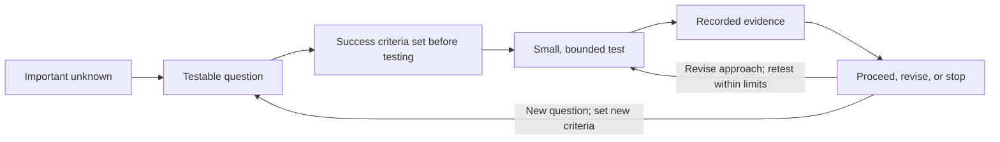

# Proof of concept

## The simple idea

A **proof of concept** (PoC) is a small experiment that helps a team answer
one important question before committing to a larger project. The question
might be “Can this service handle our data?” or “Can this application run
in the target environment?” A useful PoC starts with a specific unknown,
sets success criteria, gathers evidence, and ends in a decision.

Think of testing a bridge model in a wind tunnel to see whether the deck
shakes in strong wind. That test can expose one design problem before
construction. It cannot show how the bridge will handle traffic or years of
wear. Likewise, a PoC reduces uncertainty about the tested case; it does not
make a production system ready.

## From uncertainty to a decision

Text alternative: choose one important unknown, write a testable question
and success criteria before testing, run the smallest useful test, record
what happened, then proceed or stop. Within a preset limit, revise the
approach and retest against the same criteria; a new question needs new
criteria before testing.

A demo that merely looks promising is weak evidence. State the
constraints before testing: the workload, environment, time box,
measurement method, and the result that would change the decision.
Google Cloud's migration guidance recommends a defined scope and
specific success criteria; AWS's Redshift PoC guide starts from
business requirements and measurable targets.[^google-poc][^aws-poc]

## One bounded example

Suppose a team is considering a new search service for a public
knowledge website. The uncertainty is whether it can help readers
find the right article, including when they use beginner wording.

| Part | Illustrative PoC choice |
| --- | --- |
| Decision | Should this search approach move to a reader trial? |
| Testable question | How many of ten answerable questions show the expected article in the first five results, and does an unanswerable question produce a clear no-match outcome? |
| Decision rule, set before testing | Continue to a reader trial if at least eight of the ten answerable questions meet the first-five target and the no-answer question gives a clear no-match outcome (zero results or a no-match message). Stop this approach if fewer than five succeed. Otherwise, revise once within the time box and retest against the same rule; stop if the retest still does not meet the continue rule. |
| Test setting and time box | Use a local test site with a fixed article snapshot; complete the first test and any revision within two working days. |
| Small test | Index a fixed snapshot of articles, run the ten answerable questions, then run one question that the snapshot cannot answer. |
| Evidence | Record the snapshot revision, each query, its expected article or lack of one, returned order and snippets, misses, whether the no-match condition appeared, and setup effort. |
| Boundary | This test says nothing yet about mobile usability, accessibility, site traffic, or how articles are reviewed. |

The numbers and scenario above are **invented teaching examples**. No
search experiment was run for this page. A hypothetical result of eight of ten
answerable questions meeting the target, plus a clear no-match outcome for the
unanswerable question, would meet the stated rule for a reader trial. It would
not prove that future readers will always find what they need. If the
no-answer result is not a clear no-match outcome, the team revises the
search approach even if eight answerable questions succeeded. If the retest
still misses the rule, the team stops this approach instead of retesting
indefinitely.

## What the result can and cannot tell you

| If the PoC shows... | Reasonable conclusion | Still to do |
| --- | --- | --- |
| The must-have behavior works in the test setting. | The idea is plausible under those conditions. | Test unrepresented cases and design production controls. |
| A required condition fails. | The current approach has a blocker. | Change the design or choose another option. |
| The result is unclear. | The question, sample, or measurement may not show whether the approach meets the rule. | Tighten the question or add representative cases, then test again. |

A PoC is often built quickly, without the security, logging, recovery,
and support work needed for real users. Microsoft explicitly warns
against treating PoC code as production-ready.[^microsoft-poc] If a team
keeps experimental code, it should plan and review the missing work
before release.

A PoC aims to **learn enough to decide**. A *prototype* often makes an idea
tangible, a *pilot* tries it with a limited set of real users, and a *spike*
is a short investigation of a technical unknown. Teams use these words
differently; ask which decision the work must support rather than relying on
the label alone. None of these labels means the result is ready for a
production rollout.

## Check your understanding

- What unknown would the example PoC answer? Which important questions
  would it leave open?
- If the search test meets its decision rule, why is that not proof
  that every visitor will find the right article?
- What evidence would a teammate need to repeat or challenge the result?

## Explore further

- [Google Cloud's migration validation guidance](https://docs.cloud.google.com/architecture/migration-to-google-cloud-best-practices)
  shows how scope, criteria, and findings support a larger decision.[^google-poc]
- [Microsoft's architecture collaboration guidance](https://learn.microsoft.com/en-us/azure/well-architected/architect-role/collaboration)
  explains the production-code boundary.[^microsoft-poc]
- [AWS's Redshift PoC playbook](https://docs.aws.amazon.com/redshift/latest/dg/proof-of-concept-playbook.html)
  gives a product-specific example of selecting data and success targets.[^aws-poc]
- [Evaluation and quality](../ai/ai-tooling/knowledge-bases/evaluation-and-quality.md)
  goes deeper on measuring retrieval.
- [Back to solutions architect](index.md).

[^google-poc]: [Google Cloud, Migrate to Google Cloud: Best practices for validating a migration plan](https://docs.cloud.google.com/architecture/migration-to-google-cloud-best-practices), source record `google-poc`.
[^microsoft-poc]: [Microsoft, Collaborate with workload and platform teams](https://learn.microsoft.com/en-us/azure/well-architected/architect-role/collaboration), source record `microsoft-poc`.
[^aws-poc]: [AWS, Conduct a proof of concept (POC) for Amazon Redshift](https://docs.aws.amazon.com/redshift/latest/dg/proof-of-concept-playbook.html), source record `aws-poc`.
