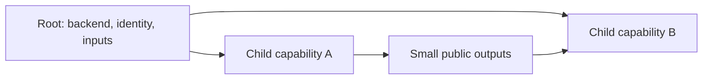

# Modules and composition

A module is a directory of Terraform configuration. The root module owns a run's backend, provider context, and composition; child modules accept inputs and expose outputs. Use a child to express a coherent reusable capability, not simply to wrap every resource in another directory.[^tf-modules]

## Design the contract before the folder tree

Define the reader/operator outcome, required inputs, supported combinations, useful defaults, outputs, and compatibility promises. A module should hide implementation details while making important choices visible. Passing the entire provider object or exposing every possible argument can make the interface harder to maintain than direct configuration.

What it does: shows the root coordinating sibling capabilities through explicit outputs. Prefer this to deeply nested children that discover or own unrelated infrastructure implicitly.

The [local module lab](../examples/module-workspace-lab/index.md) passes service name, environment, selected workspace, release version, and replicas to a small child. `release_version` is intentionally not named `version`: `version` is a module-call meta-argument for selecting a remote module, not an ordinary release input. The lab is a state-backed teaching contract, not a deployment module.

## Select and pin sources deliberately

| Source | Reproducibility decision |
| --- | --- |
| Local relative path | Changes arrive with the root repository revision. |
| Terraform registry | Select a reviewed exact version for a reproducible teaching/deployment baseline. |
| Git | Prefer an immutable reviewed commit; a branch moves and a tag may be retagged. |

Module source and version semantics are distinct from provider requirements. `.terraform.lock.hcl` does not lock remote module selections; pin them separately and review upgrades.[^tf-module-sources] Source installation can execute dependency retrieval, so review the trust boundary before initializing third-party code.

## Keep runtime context at the root

Reusable children declare provider requirements but normally receive configured providers from the caller. For alternate configurations, declare the expected child aliases and map them explicitly in the module call.[^tf-module-providers] See the [provider lab](../examples/provider-alias-lab/index.md) for an executable alias example. Hardcoding cloud credentials inside a child makes reuse and permission review difficult.

## Refactor identity as well as files

Moving a block between `.tf` files inside the same module does not change its address. Renaming a resource or moving it into a child can. Use a compatible `moved` block and review a plan that preserves the intended binding rather than assuming a textual refactor is harmless. Retaining historical moves preserves upgrade paths for older consumers.[^tf-moved]

The lab runner renames its child's built-in resource, observes two `previous_address` entries with no create/delete actions, applies the move, and confirms both IDs survive. That is evidence for this local refactor only; provider-specific type moves and splitting real shared states require their own migration plan and tests.

## Evidence and limits

Sources reviewed on 2026-10-29. Local examples were executed with Terraform 1.17.1; the provider lab uses hashicorp/local 2.9.1. These runs cover local state/files, not cloud IAM, remote locking, backend migration, imports, or hosted execution. The guides remain drafts with unassigned ownership. Replace angle-bracket placeholders and confirm the actual root, backend, workspace, and provider identity before adapting commands.

## Related routes

- [Environment layouts](environment-layouts.md).
- [Stable keys](../language/expressions-and-stable-instance-keys.md).
- [Back to this section](index.md)
- [Back to Terraform](../index.md)

[^tf-modules]: [Developing modules](https://developer.hashicorp.com/terraform/language/modules/develop)
[^tf-module-sources]: [Using and versioning modules](https://developer.hashicorp.com/terraform/language/modules/configuration)
[^tf-moved]: [Refactoring with moved blocks](https://developer.hashicorp.com/terraform/language/modules/develop/refactoring)
[^tf-module-providers]: [Providers within modules](https://developer.hashicorp.com/terraform/language/modules/develop/providers)
